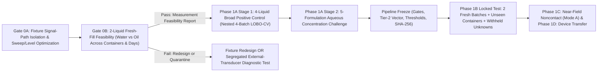

# LIQUID ANALYZER: Phase 1 v1.2 Master Specification

**Document ID:** `CS-SPEC-P1-v1.2` *(retained document identifier; application renamed from Chemical Sound to Liquid Analyzer)*  
**Supersedes:** `CS-SPEC-P1-v1.1`  
**Document status:** Controlled development specification (Candidate for Freeze)  
**System classification:** Experimental acoustic liquid-response measurement & reference-matching instrument  
**Primary hardware domain:** `IPHONE_NATIVE` (Single baseline Apple iPhone)  
**Diagnostic fallback domain:** `EXTERNAL_TRANSDUCER_DIAGNOSTIC` (Strictly segregated; non-transferable to phone-only claims)  
**Primary measurement mode:** `MODE_B` (Controlled indirect mechanical coupling)  
**Analysis model:** Offline-first authoritative Python reference implementation  
**Intended use:** Controlled laboratory feasibility research only  

---

## 1. Purpose & Governing Scientific Statement

**Liquid Analyzer** is a controlled acoustic-response measurement instrument designed to test whether liquid samples in a standardized container produce repeatable, batch-generalizable vibro-acoustic signatures using an iPhone's built-in transducers.

The instrument measures the **coupled physical system** comprising:
1. The liquid bulk (density, sound speed, viscosity, meniscus wetting, dissolved gas).
2. The standardized container wall, cap closure, fill height, and headspace.
3. The coupling pad, clamping mechanism, acoustic septum, and fixture structure.
4. The iPhone speaker, chassis, microphone, and negotiated iOS audio signal chain.
5. The ambient thermal and acoustic environment.

> [!IMPORTANT]
> **Governing Rule:** A high classification score is insufficient. Phase 1 succeeds only if experimental controls prove that the measured signature **follows the liquid across fresh fills, independent preparation batches, unseen containers, and separate days**, rather than tracking container identity, sample weight, clamping force, session drift, or background noise.

**Explicit Non-Claims:** Phase 1 shall never claim to determine molecular formula, chemical purity, toxicity, drinkability, safety, medical status, pharmaceutical identity/potency, trace contamination, or arbitrary-container liquid identity. Outputs express **empirical similarity to calibrated references within tested operating bounds**, never definitive chemical proof.

---

## 2. Sequential Experimental Roadmap & Gate Structure

Rather than launching directly into an 8-liquid study, Phase 1 enforces **sequential experimental gates**:



1. **Gate 0A — Signal-Path & Excitation Characterization**: Execute the 5-state path-isolation experiment, container screening, and sweep-duration/playback-level matrix. **Rule:** *Do not freeze the fixture or temporal gates until the dominant useful signal path is demonstrated experimentally.*
2. **Gate 0B — Two-Liquid Fresh-Fill Feasibility (`Measurement Feasibility Report`)**: Test whether the instrument reliably separates `Distilled Water` from `Vegetable Oil` across **independent fills, removal-and-replacement cycles, multiple containers, and multiple sessions/days**, alongside `Controls K1/K2`, volume, temperature, and drift checks.
3. **Phase 1A — Staged Exploratory Dataset (4 Batches, Nested LOBO-CV)**:
   - **Stage 1 (Broad Positive Control)**: `Distilled Water`, `Vegetable Oil`, `Whole Milk`, `White Vinegar`.
   - **Stage 2 (Aqueous Concentration Challenge)**: `Distilled Water`, `NaCl 1.0% w/w`, `NaCl 10.0% w/w`, `Sucrose 5.0% w/w`, `Sucrose 20.0% w/w`.
   - **Stage 3 (Combined Reference Library)**: Merged validated formulations from Stages 1 & 2.
4. **Phase 1B — Locked Independent Test**: Evaluate the frozen pipeline once on **2 newly prepared batches per formulation**, **reserved unseen containers**, and **withheld unknown formulations**.
5. **Phase 1C & 1D**: Near-field noncontact (`Mode A`) comparison and secondary iPhone transferability (`Phase 1D`), deferred until Phase 1B passes.

---

## 3. Baseline Hardware & Segregated Fallback Domain

### 3.1 Primary Domain (`hardware_domain = IPHONE_NATIVE`)
- Designate **one physical iPhone** as the sole Phase 1A/1B baseline instrument (`case_status = NONE`, unplugged or fixed documented charging state).
- Record commercial name, hardware identifier (e.g., `iPhone16,1`), iOS version, app version, research device ID, enumerated input/output ports, microphone data sources, polar patterns, channel counts, negotiated sample rate, input/output latency, I/O buffer duration, hardware `outputVolume`, battery/charging state, thermal state, and orientation.

### 3.2 Diagnostic Fallback Domain (`hardware_domain = EXTERNAL_TRANSDUCER_DIAGNOSTIC`)
- If Gate 0A/0B demonstrates that iPhone-only excitation/sensing cannot separate liquid responses above repositioning variance after fixture refinement, the project may run a controlled diagnostic comparison using an **external contact exciter and contact pickup (e.g., piezo/accelerometer)** to determine whether container-liquid physics or iPhone coupling is the limiting factor.
- **Quarantine Rule:** Recordings from `EXTERNAL_TRANSDUCER_DIAGNOSTIC` shall carry a distinct `hardware_domain` tag, shall never enter `IPHONE_NATIVE` training/validation sets, and shall never be cited as evidence of iPhone-only feasibility.

---

## 4. Fixture Signal-Path Architecture & Path-Isolation Protocol

### 4.1 Mandatory Cross-Sectional Signal-Path Definition

Every fixture revision (`fixture_version`) must be accompanied by a dimensioned cross-sectional engineering drawing specifying all six elements below:

```text
   [ Rigid Clamping Arm / Calibrated Spring F_c ]
                        |
                        v
            +-----------------------+  <-- Standardized Cap Closure (Torque Mark / Snap Stop)
            |     Headspace (h_air) |
            |~~~~~~~~~~~~~~~~~~~~~~~|  <-- Liquid Meniscus (Fill Height h_liq)
            |                       |
   Rigid    |     Liquid Sample     |       Acoustic Septum / Baffle (Closed-Cell Foam + Mass Layer)
  Backstop  |      (PP Vessel)      |      Blocks direct airborne Port-S -> Port-M short-circuit
   V-Block  |                       |              |
     |      |                  [Pad]|==============+===================+
     +----->|                  [ P ]|<-- Coupling Pad (Material, Shore A, Thickness t0 -> tc, Area Ac)
            +-----------------------+    Contacts container wall BELOW meniscus; bridges vibro-acoustic
               ^                         energy between active iPhone bottom zone and vessel wall.
               |                           |                       |
   ============+===========================+=======================+============
   [ Vibration-Isolated Baseplate ]     [Port S: Active Speaker] [Port M: Active Mic]
                                        [        Baseline iPhone (No Case)          ]
```

1. **Excitation Interface (`Port S → Container`)**: Exact active speaker outlet location verified by port-occlusion probe, coupled into the lower container wall (strictly below `h_liq`) via a defined elastomer/polymer coupling pad (documented material, Shore hardness, uncompressed thickness $t_0$, compressed thickness $t_c$, and contact area $A_c$).
2. **Receiving Interface (`Container → Port M`)**: Exact active microphone inlet geometry relative to the container wall (either coupled via a secondary isolated sensing pad or recessed in a shielded near-field cavity viewing the vibrating container wall).
3. **Airborne Bypass Suppression**: Non-contacting acoustic septum/baffle positioned between `Port S` and `Port M` to attenuate direct airborne speaker-to-microphone bleed without touching the vibrating container zone.
4. **Structural Frame Path**: Rigid cradle + container V-block mounted on elastomer isolation pads so baseplate resonances are damped and repeatable.
5. **Force Control**: Calibrated spring plunger, detent lever, or counterweight applying reproducible normal force $F_c$ independent of sample liquid weight. Hand-held pressure is prohibited.

### 4.2 Mandatory 5-Condition Path-Isolation Experiment (Gate 0A)

Before freezing `fixture_version` or selecting features, execute $N \ge 5$ repetitions of each condition below:

| Condition ID | Physical Configuration | Primary Metrology Question |
| :--- | :--- | :--- |
| **`PATH_01_FIXTURE_ONLY`** | Phone + fixture + coupling pad armed; **no container present** | What baseline structural/chassis bleed exists without the vessel? |
| **`PATH_02_EMPTY_ENGAGED`** | Standardized empty capped PP container engaged at nominal force $F_c$ | What dry structural modes does the container contribute? |
| **`PATH_03_WATER_ENGAGED`** | Distilled-water filled container engaged at nominal force $F_c$ | How much do modal frequencies, amplitudes, and ring-down shift upon fluid loading? |
| **`PATH_04_WATER_DISENGAGED`** | Same water-filled container retracted `1–2 mm` so coupling pad **breaks mechanical contact** while preserving approximate geometry | How much of the liquid signal requires solid mechanical contact vs. airborne coupling? |
| **`PATH_05_AIR_BAFFLE_MOD`** | Engaged water-filled container with supplemental non-contacting acoustic barrier/plug altering the airborne port path | How much of the recorded return is airborne bypass vs. structural wall transmission? |

### 4.3 Controls `K1` and `K2` (Operational & Interpretive Rules)
- **`Control K1` (Added External Mass)**: Attach calibrated non-wetting deadweights (`+10%`, `+20%` of nominal water mass) symmetrically to a rigid collar on the **upper cap rim above the headspace**, without touching the coupling pad or wetted wall. Log `added_deadweight_g`, `deadweight_attachment_location`, and `deadweight_method`.
  - *Interpretive Boundary:* `K1` tests whether fixture baseplate/contact deflection acts as a crude weighing scale. A small `K1` effect **does not** imply liquid density is unimportant to true fluid-loaded wall modes; rather, a *large* `K1` shift matching liquid class differences warns of a fixture-deflection artifact.
- **`Control K2` (Coupling Force Perturbation)**: Hold container, liquid fill, and mass constant while stepping clamping force across `Low (-20%)`, `Nominal`, and `High (+20%)` settings to establish required fixture force tolerance.

---

## 5. Container Screening, Crossed Allocation & Boundary Conditions

### 5.1 Candidate Screening
Screen $\ge 3$ thin-walled polypropylene (PP) tube/cup designs by product number and lot across: empty repeatability, water repeatability, empty-vs-water separation, remove-and-replace variance, unit-to-unit variance, cap seal integrity, and fixture fit.

### 5.2 Explicit Crossed Container Design & Oil-Carryover Safeguard
To prove the classifier identifies the **liquid** rather than individual `container_id` manufacturing quirks:
1. **Multi-Container Crossing (Aqueous Classes)**: Measure each aqueous formulation across multiple `container_id` units, and assign each reusable aqueous `container_id` to multiple formulations in randomized order following a **validated wash–DI-rinse–complete-dry SOP** verified by periodic empty/water blank checks.
2. **Oleophilic Residue Rule (Lipid/Oil Classes)**: Because polypropylene adsorbs hydrophobic oil films that alter subsequent aqueous meniscus wetting, containers exposed to `Vegetable Oil` or `Whole Milk` shall **not** re-enter aqueous testing unless a validated surfactant + isopropanol + DI-water wash passes a quantitative water-blank equivalence gate. Otherwise, allocate **lot-matched virgin containers** in a randomized balanced block across multiple `container_id`s per formulation, with fresh fills for every `sample_id`.
3. **Reserved Unseen Container Holdout**: Quarantine a subset of virgin `container_id` units (never used in Gate 0B or Phase 1A training) exclusively for locked validation and Phase 1B testing.

### 5.3 Tightened Physical Boundary Conditions
- **Closure Condition**: Explicitly standardize `OPEN` vs. `CAPPED`; if capped (recommended baseline to prevent evaporation and spill), standardize closure torque mark or positive snap stop (`cap_closure_state`).
- **Fill Geometry**: Record `measured_mass_g`, `nominal_volume_ml`, **measured liquid column height (`fill_height_mm`)**, and **headspace height (`headspace_height_mm`)** relative to coupling-pad centerline.
- **Temperature Measurement SOP**: Specify thermometer type, calibration check, and exact timing (`temp_measurement_method`, `temp_measurement_timing` — e.g., calibrated probe in companion witness aliquot or pre-settle measurement prior to 3-minute bubble rest so probe insertion never nucleates fresh wall bubbles immediately before scanning).
- **Degassing & Settling**: Mix prepared solutions $\ge 30\text{ min}$ before scanning; pour gently along wall; perform standardized tap if needed; enforce and log a **3.0-minute stationary post-fill settle timer** (`sample_rest_duration_sec >= 180`).

---

## 6. Audio Session, Excitation Optimization & Gate-Separability Gate

### 6.1 Requested vs. Verified `AVAudioSession` Contract
- Request `.playAndRecord` + `.measurement` mode, `48,000 Hz`, mono built-in input, stable microphone data source, `.omnidirectional` polar pattern where supported, and built-in speaker output; reject any external route (Bluetooth, AirPods, USB, wired headset, AirPlay, CarPlay).
- **Runtime Verification:** Record requested and post-activation actual values separately (`verified_audio_mode`, `verified_sample_rate_hz`, ports, data sources, channel counts, latencies, `ioBufferDuration`, pre/post `outputVolume`). Note Apple's documentation that `.measurement` mode minimizes system dynamics processing while reducing playback gain; empirical bench characterization on the baseline iPhone is mandatory.

### 6.2 Pilot Excitation Optimization Matrix (Gate 0A)
Before locking waveform settings or features, evaluate a structured pilot grid on Empty vs. Water vs. Oil:
1. **Sweep Duration (`SIG_ESS`)**: Compare `200 ms` (pilot start) vs. `500 ms` and `1,000 ms` (`400 Hz – 14 kHz`, `-6 dBFS` digital peak, `10 ms` tapered fades) to test whether longer integration improves deconvolution SNR under `.measurement` mode's reduced output gain without triggering thermal compression.
2. **Hardware Playback Levels**: Compare 3–4 fixed iOS `outputVolume` targets (e.g., `0.50`, `0.65`, `0.80`, tolerance `±0.01`) for SNR vs. speaker harmonic distortion and 5-repetition thermal drift.
3. **Post-Roll Capture Window**: Compare `150 ms` vs. `300 ms` post-roll for complete modal ring-down capture.
4. **Excitation Modality**: Compare ESS deconvolved features against `SIG_STEP_v1` stepped-tone (`60 ms` tone + `40 ms` speaker-silent decay gap) features.
- **Selection Rule:** Freeze the excitation protocol maximizing **within-sample repeatability and across-container/batch separation**, never raw spectral amplitude.

### 6.3 Explicit Temporal Gate-Separability Acceptance Test

> [!WARNING]
> Do not force arbitrary `Direct-Path`, `Early-Tail (Resonance)`, and `Late-Room` sample cutoffs if the physical geometry blurs them together.

Gate 0A shall inspect deconvolved impulse envelopes across `PATH_01` through `PATH_05`:
- **Pass Criterion for Split Gating:** `PATH_03 (Water Engaged)` exhibits a repeatable post-bleed modal decay envelope exceeding the noise floor and diverging from `PATH_01 (Fixture Only)` and `PATH_04 (Disengaged)` within a definable window $[t_0 + t_d,\, t_0 + t_r]$.
- **Fallback if Unseparated:** If mechanical contact overlaps the initial arrival without a separable bleed boundary, rely on (a) full impulse window differential calibration (`Sample - Fixture/Empty`) and/or (b) `SIG_STEP_v1` post-tone **speaker-silent** `40 ms` decay intervals where active speaker bleed is physically zero.

---

## 7. Three-Tier Feature Governance (Resolving v1.1 Section 16 vs. 19.10)

To prevent silent feature-vector inflation, all extracted quantities belong to one of three mutually exclusive governance tiers:

| Tier | Name | Scope & Contents | Classifier Eligibility |
| :--- | :--- | :--- | :--- |
| **Tier 1** | **Candidate Feature Library** | Exploratory pool in Python (`16–24` diff log-bands, up to 3 modal frequencies/prominences/widths/Q-factors, T20/Schroeder slopes, stepped-tone silent-gap decay slopes, water/empty distances, direct-to-tail ratio) — each documented with unit, formula, source region, and missing rule. | Eligible for selection **only inside inner development folds** during Phase 1A. |
| **Tier 2** | **Frozen Classifier Vector** | Explicitly enumerated compact subset (**hard ceiling $d \le 25$; pilot target $d = 8\text{–}20$** given 4 batches/class) demonstrating repeatability, low `K1/K2`/position sensitivity, and batch generalization. Raw unwrapped phase is prohibited. | **Sole input** to the Phase 1B locked classifier (verified by feature-schema SHA-256). |
| **Tier 3** | **QC & Diagnostic-Only Features** | Clipping count, pre-roll RMS/bands, `Direct-Path` nuisance features, intra-sample variance, cross-correlation ambiguity, harmonic distortion ratio, and `CAL_START`/`CAL_END` drift metrics. | **Strictly prohibited** as liquid classifier inputs; used only for QC gating and leakage auditing. |

---

## 8. Reconciled Timing, State Machine & Session-Drift Validity Lifecycle

### 8.1 Reconciled Repetition Sequence & Cooldown Timing (Resolving v1.1 Sec 20.4 vs. 20.6)

For every repetition, state transitions and timing follow one canonical order:
1. `Armed` (verify route, `sampleRate`, metadata, and pre-scan `outputVolume`)
2. `Recording pre-roll` (`150 ms` default)
3. `Playing excitation` (record exact hardware/host start & end timestamps $t_{\text{exc\_start}}, t_{\text{exc\_end}}$)
4. `Recording post-roll` (`150–300 ms`)
5. `Saving` (atomic write of lossless mono Float32 WAV + SHA-256 + post-scan `outputVolume` read; **cooldown clock starts at $t_{\text{exc\_end}}$**)
6. `Evaluating immediate QC` (computed immediately on saved buffer *concurrently* with the cooldown timer)
7. `Cooling down` (enforced wait until wall-clock time satisfies **$t \ge t_{\text{exc\_end}} + \Delta t_{\text{cooldown}}$**, provisional $\Delta t_{\text{cooldown}} = 2.0\text{ s}$)
8. Transition to **`Repetition provisionally accepted`** (`PROVISIONALLY_ACCEPTED`) or **`Repetition rejected`** (`REJECTED` / `INTERRUPTED` / `INCOMPLETE`).

**Hard Timing Invariant:** Regardless of whether immediate QC finishes in `15 ms` or `400 ms`, the next repetition's `Playing excitation` state **shall never begin** before $t_{\text{prev\_exc\_end}} + \Delta t_{\text{cooldown}}$.

### 8.2 Two-Stage Scan & Session Calibration Validity
Because end-of-session calibration (`CAL_END` distilled water + empty container check) occurs *after* sample scans are recorded:
1. **On-Device Acquisition Status (`acquisition_qc_state`)**: Validated individual scans receive **`PROVISIONALLY_ACCEPTED`** (replacing unqualified on-device `PASS`), alongside `REJECTED`, `INTERRUPTED`, or `INCOMPLETE`.
2. **Post-Calibration Session Status (`session_validity_state`)**:
   - `SESSION_OPEN`: Session in progress (`CAL_END` not yet completed).
   - `SESSION_VALID`: Beginning-to-ending calibration drift (`CAL_START` vs. `CAL_END`, plus periodic water checks) is within the frozen pilot limit. All `PROVISIONALLY_ACCEPTED` scans in the session are promoted to **`FINAL_ACCEPTED`**.
   - `SESSION_DRIFT_INVALIDATED`: Calibration drift exceeds limit (`CALIBRATION_DRIFT` flag). Affected scans since the last valid periodic water check are downgraded to **`INVALID_MEASUREMENT`** and excluded from training and classification claims, while remaining in the audit log.

---

## 9. Nested Validation, Three-State Output & Withheld Unknowns

### 9.1 Nested Model Selection & Hierarchical Statistical Reporting
1. **Nested Batch-Grouped Cross-Validation**: Whenever Phase 1A compares Tier-1 feature subsets, passbands, hyperparameters, or rejection thresholds, selection **must occur inside an inner leave-one-batch-out loop** (3 training batches → 2 inner-train / 1 inner-val) before evaluating the single chosen pipeline once on the outer held-out 4th batch. Repeatedly tuning choices by inspecting outer 4-batch LOBO scores invalidates the outer estimate as unbiased evidence.
2. **Hierarchical Reporting Unit**:
   - Primary prediction unit: **Physical Sample** (robust median aggregate of its `FINAL_ACCEPTED` technical repetitions).
   - Every report must display **per-batch accuracy and batch-to-batch range/SD** prominently alongside pooled sample accuracy so technical repetitions are never conflated with independent preparations.
   - Bootstrap confidence intervals and label-permutation tests **must resample/permute at the batch / experimental-allocation level**, never shuffling individual repetitions across batches.
   - Scan/session QC rejections (`INVALID_MEASUREMENT`) are reported in an explicit acquisition-yield table, never silently dropped or merged with classifier rejections.

### 9.2 Three-State System Output Contract

| System Output | Operational Definition | Triggering Conditions |
| :--- | :--- | :--- |
| **`INVALID_MEASUREMENT`** | Acquisition, sample-prep, or session calibration failed QC; sample was **not** validly interrogated. | Failed immediate QC (`REJECTED`/`INTERRUPTED`/`INCOMPLETE`), insufficient valid repetitions, or `SESSION_DRIFT_INVALIDATED`. |
| **`NO_VALIDATED_MATCH`** | Valid acoustic measurement obtained, but response does not meet strict criteria for any calibrated library reference. | Passed QC & session drift, **and** failed class-conditional Mahalanobis distance ($d_{(1)} > \tau_{\text{dist}}$), nearest-class margin ($d_{(2)} - d_{(1)} < \tau_{\text{margin}}$), or repetition agreement ($< \tau_{\text{agree}}$). |
| **`REFERENCE_MATCH (<ID>)`** | Valid measurement consistent with a calibrated reference class within tested operating bounds. | Passed QC & session drift, **and** satisfied distance boundary, nearest-class margin, and repetition consistency. |

### 9.3 Dual-Category & Strictly Withheld Unknown Evaluation
Unknown evaluation is a primary objective, tested across two distinct categories:
1. **Category `UNK_OUTER` (Distinct Non-Library Liquids)**: Safe liquids outside the training domain (e.g., diluted glycerol, culinary soy sauce, apple juice) testing the outer Mahalanobis distance boundary $\tau_{\text{dist}}$.
2. **Category `UNK_INTERMEDIATE` (Excluded Intermediate Concentrations)**: Formulations lying *between* trained concentration classes (e.g., `NaCl 4.0% w/w` between `1.0%` and `10.0%`, or `Sucrose 12.0% w/w` between `5.0%` and `20.0%`). Because interpolative samples may sit inside the outer distance envelope between adjacent centroids, they specifically stress-test the **nearest-class margin boundary** $\tau_{\text{margin}}$; reports must document both `NO_VALIDATED_MATCH` rates and nearest-bracket assignment behavior.
3. **Withheld Phase 1B Unknowns**: At least **50% of unknown test formulations** (including both `UNK_OUTER` and `UNK_INTERMEDIATE` examples) shall be **completely withheld** during Phase 1A threshold tuning and revealed only during the locked Phase 1B evaluation.

---

## 10. Updated Milestone Sequence (v1.2)

1. **Milestone 1 — v1.2 Specification Freeze**: Lock `CS-SPEC-P1-v1.2`, designate baseline iPhone, select $\ge 3$ candidate PP containers, and draft initial Mode B cross-sectional fixture drawing.
2. **Milestone 2 — Python v1.2 Reference Pipeline**: Implement waveform generator, ingestion/alignment, ESS + stepped-tone analyzers, 3-tier feature governance, nested LOBO-CV, 3-state output (`INVALID_MEASUREMENT` / `NO_VALIDATED_MATCH` / `REFERENCE_MATCH`), and path-isolation analytics.
3. **Milestone 3 — Minimal Swift Acquisition Instrument**: Build acquisition-only iOS app with reconciled cooldown/QC state machine, `PROVISIONALLY_ACCEPTED` → `SESSION_VALID` lifecycle, and lossless bundle export.
4. **Milestone 4 — Measurement Feasibility Report (Gate 0A + Gate 0B)**: Execute 5-state path isolation, container screening, sweep/level optimization, `Controls K1/K2`/fill/temp/drift, and **2-liquid (`Water` vs. `Oil`) multi-container, multi-session fresh-fill feasibility test**. Issue formal **Proceed / Redesign Fixture / External-Fallback Decision**.
5. **Milestone 5 — Phase 1A Exploratory Dataset**: Collect Stage 1 (broad positive control) and Stage 2 (5-formulation concentration challenge) across 4 independent batches using crossed/balanced containers.
6. **Milestone 6 — Pipeline Freeze**: Select Tier-2 compact vector ($\le 25$ features), gates, normalization, baseline classifier, and $\tau_{\text{dist}} / \tau_{\text{margin}}$ via nested LOBO-CV; record frozen SHA-256 manifest.
7. **Milestone 7 — Phase 1B Locked Independent Test**: Evaluate unmodified frozen pipeline once on 2 newly mixed batches/class, unseen `container_id` units, and strictly withheld `UNK_OUTER` + `UNK_INTERMEDIATE` unknowns.
