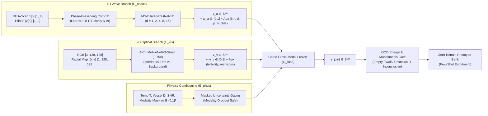
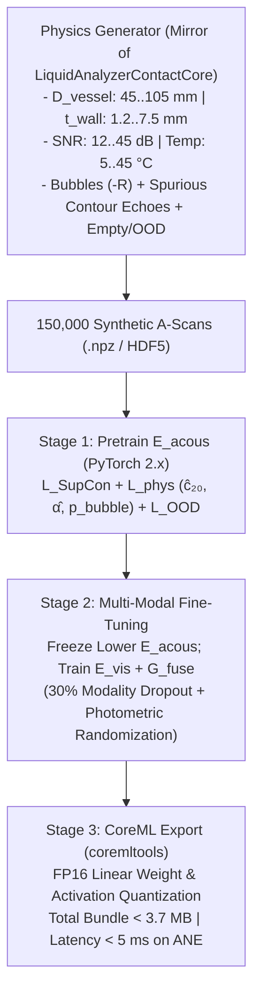

# LA-ML-ARCH-001: Physics-Informed Multi-Modal Matter Perception Architecture (`MatterJEA`)

- **Document ID:** `LA-ML-ARCH-001`
- **Version:** `1.0.0`
- **Status:** LOCKED / APPROVED FOR IMPLEMENTATION
- **Target Runtimes:** Apple CoreML / Neural Engine (iOS 17+, `Swift 5.10 / 6.x`), PyTorch `2.x` (Sim-to-Real Training & Export)
- **On-Device Budget:** `< 4.0 MB` FP16 `.mlpackage`, `< 6.0 ms` end-to-end latency on iPhone A16/A17/M-series ANE (`100%` offline)
- **Related Specs:** [`LA-R3-SPEC-001.md`](LA-R3-SPEC-001.md) (`MODE_B` Transducer, AFE & Binary Wire Protocol v1.0.0), [`LA-V050-FUSION-PLAN-001.md`](LA-V050-FUSION-PLAN-001.md) (`v0.5.0` Phone-Only Multi-Modal Fusion)

---

## 1. Architectural Rationale & Global Embedding Manifold

Hand-tuned scalar thresholds (e.g., `sat >= 0.34`, concentric rim heuristics) are brittle under real-world lighting, curved glassware refraction, and multi-path acoustic reflections, while unconstrained black-box vision models cheat by memorizing kitchen counters or room shadows.

**`MatterJEA`** (Physics-Informed Joint Embedding Architecture) resolves both failure modes by projecting heterogeneous **1D ultrasonic/acoustic waves**, **2D spatial optics**, and **physical metadata** onto a shared unit hyperspherical manifold grounded by physical auxiliary losses:

$$\mathbf{z} \in \mathbb{S}^{127} = \left\{ \mathbf{v} \in \mathbb{R}^{128} \;\middle\vert\; \Vert\mathbf{v}\Vert_2 = 1.0 \right\}$$



---

## 2. Encoder Specifications & Layer Topologies

### 2.1 Acoustic 1D Wave Encoder ($E_{\text{acous}}$)
- **Input Tensor:** $\mathbf{X}_{\text{acous}} \in \mathbb{R}^{B \times 2 \times L}$ (nominal $L = 8{,}800$ samples $= 220\ \mu\text{s}$ at $40\text{ MSPS}$; supports $L = 12{,}000$ via adaptive pooling for wide `80–90 mm` Ethanol vessels):
  - **Channel 0:** Normalized signed RF A-Scan $x[n] \in [-1.0, +1.0]$ (preserves $+R$ rigid-wall vs. $-R$ $180^\circ$ inverted air-bubble phase polarity).
  - **Channel 1:** Analytic Hilbert envelope $|z[n]| \in [0.0, 1.0]$ (computed via `LiquidAnalyzerContactCore.computeEnvelope`).
- **Backbone (`MS-Dilated-ResNet-1D`):**
  - **Stem:** `Conv1D(2 -> 32, k=15, stride=4) -> BatchNorm1D -> GELU`
  - **Stage 1:** 2 residual blocks, `32` channels, dilations $d \in \{1, 2\}$
  - **Stage 2:** 2 residual blocks, `64` channels, stride `2` downsampling, dilations $d \in \{2, 4\}$
  - **Stage 3:** 2 residual blocks, `128` channels, dilations $d \in \{4, 8\}$ (spans $t_1 \to t_2$ double-echo interval $\Delta t \approx 60\text{--}150\ \mu\text{s}$)
  - **Stage 4:** 2 residual blocks, `128` channels, dilations $d \in \{8, 16\}$ (captures full reverberation decay envelope)
- **Heads:**
  - Embedding: `AdaptiveAvgPool1d(1) -> Linear(128 -> 128) -> L2Norm -> z_a`
  - Reliability logit: `Linear(128 -> 1) -> Sigmoid -> w_a`
  - Physics Auxiliary Heads (training-time anchors): $\hat{c}_{20^\circ\text{C}}$, $\hat{\alpha}_{\text{dB/cm}}$, $\hat{p}_{\text{bubble}}$
- **Footprint:** $\approx 280\text{K}$ parameters (`0.56 MB` FP16).

### 2.2 Optical 2D Spatial Encoder ($E_{\text{vis}}$)
- **Input Tensor:** $\mathbf{X}_{\text{vis}} \in \mathbb{R}^{B \times 4 \times 128 \times 128}$:
  - **Channels 0..2:** Normalized RGB color channels $\in [0.0, 1.0]$.
  - **Channel 3:** Normalized radial reticle coordinate map (eliminates brittle hardcoded concentric rim rings across top-down vs. side-view glasses):
    $$r(x, y) = \frac{\sqrt{(x - x_c)^2 + (y - y_c)^2}}{\sqrt{x_c^2 + y_c^2}} \in [0.0, 1.0]$$
- **Backbone:** Modified `MobileNetV3-Small` (`0.75×` width multiplier), 4-channel input stem (channel 3 initialized as mean of pretrained RGB stem weights), Hard-Swish activations, Squeeze-and-Excitation ratio `0.25`.
- **Heads:**
  - Embedding: `GlobalAvgPool2d -> Linear(576 -> 128) -> L2Norm -> z_v`
  - Reliability logit: `Linear(576 -> 1) -> Sigmoid -> w_v`
  - Physics Auxiliary Heads: $\hat{\text{turbidity}}$, $\hat{\theta}_{\text{meniscus}}$
- **Footprint:** $\approx 1.41\text{M}$ parameters (`2.82 MB` FP16).

### 2.3 Masked Uncertainty-Gated Cross-Modal Fusion ($G_{\text{fuse}}$)
Accepts $(\mathbf{z}_a, w_a, \mathbf{z}_v, w_v)$, scalar metadata `(ambient_temp_c, snr_db, gain_db)`, and binary sensor availability mask $\mathbf{m} = (m_a, m_v) \in \{0, 1\}^2$:

1. **Masked Soft-Gating** (unavailable sensors are masked to $-\infty$ before softmax so missing channels never inject noise):
   $$\ell_k = \begin{cases} \text{MLP}_k(w_k, \text{meta}) / \tau_{\text{gate}} & \text{if } m_k = 1 \\ -\infty & \text{if } m_k = 0 \end{cases}, \qquad (\tilde{w}_a, \tilde{w}_v) = \text{Softmax}(\ell_a, \ell_v)$$
2. **Cross-Attention Interaction** (gated by $m_a \cdot m_v$ so it vanishes cleanly in single-sensor mode):
   $$\mathbf{h}_{\text{cross}} = (m_a m_v) \cdot \text{MultiHeadAttention}\!\left(\mathbf{Q} = \mathbf{z}_v \mathbf{W}_Q,\; \mathbf{K} = \mathbf{z}_a \mathbf{W}_K,\; \mathbf{V} = \mathbf{z}_a \mathbf{W}_V\right)$$
3. **Unit-Hypersphere Projection:**
   $$\mathbf{z}_{\text{raw}} = \tilde{w}_a \phi_a(\mathbf{z}_a) + \tilde{w}_v \phi_v(\mathbf{z}_v) + \alpha_{\text{cross}} \mathbf{h}_{\text{cross}}, \qquad \mathbf{z}_{\text{joint}} = \frac{\mathbf{z}_{\text{raw}}}{\Vert\mathbf{z}_{\text{raw}}\Vert_2}$$
- **Footprint:** $\approx 140\text{K}$ parameters (`0.28 MB` FP16).

---

## 3. Multi-Objective Training Formulation

$$\mathcal{L}_{\text{total}} = \mathcal{L}_{\text{SupCon}} + \lambda_1 \mathcal{L}_{\text{CLIP}} + \lambda_2 \mathcal{L}_{\text{phys}} + \lambda_3 \mathcal{L}_{\text{OOD}}$$

Recommended baseline weights: $\lambda_1 = 0.50$, $\lambda_2 = 1.00$, $\lambda_3 = 0.35$.

1. **Supervised Contrastive Loss ($\mathcal{L}_{\text{SupCon}}$, $\tau = 0.07$):** Pulls scans of the same liquid together across arbitrary vessel diameters, glass wall thicknesses, temperatures, and room illuminants while pushing distinct chemicals apart:
   $$\mathcal{L}_{\text{SupCon}} = -\sum_{i} \frac{1}{|P(i)|} \sum_{p \in P(i)} \log \frac{\exp(\mathbf{z}_i \cdot \mathbf{z}_p / \tau)}{\sum_{a \neq i} \exp(\mathbf{z}_i \cdot \mathbf{z}_a / \tau)}$$
2. **Cross-Modal CLIP Alignment ($\mathcal{L}_{\text{CLIP}}$):** Symmetric InfoNCE loss aligning paired acoustic ($\mathbf{z}_a$) and optical ($\mathbf{z}_v$) embeddings — plus optional chemical-property anchor vectors (textbook $c_{20^\circ\text{C}}$, pH, refractive index $n$).
3. **Physics-Consistency Auxiliary Losses ($\mathcal{L}_{\text{phys}}$):**
   - Sound Velocity: $\text{HuberLoss}(\hat{c}_{20^\circ\text{C}} - c_{\text{true}}, \delta = 5.0\text{ m/s})$
   - Attenuation: $\text{MSE}(\hat{\alpha}_{\text{dB/cm}} - \alpha_{\text{true}})$
   - Bubble Polarity: $\text{BCEWithLogits}(\hat{p}_{\text{bubble}}, y_{\text{inverted\_bubble}})$
   - Prevents shortcut learning on room backgrounds or fixed glass thickness.
4. **Open-Set Energy & Prototype Margin Gate ($\mathcal{L}_{\text{OOD}}$):**
   $$E(\mathbf{z}; \{\boldsymbol{\mu}_k\}) = -T \cdot \log \sum_{k=1}^{K} \exp\!\left(\frac{\mathbf{z} \cdot \boldsymbol{\mu}_k}{T}\right)$$
   - Trained with explicit negative cohorts (**Empty Containers, Solid Walls, Clipped/Low-SNR Noise, & Withheld Open-Set Liquids**), enforcing $E(\mathbf{z}_{\text{in-dist}}) \le m_{\text{in}} = -4.0$ and $E(\mathbf{z}_{\text{OOD}}) \ge m_{\text{out}} = 0.0$.
   - **Modality Dropout:** Randomly drop acoustic (`m_a = 0`) or optical (`m_v = 0`) branches on 30% of training batches so single-modality degradation remains calibrated.

---

## 4. On-Device CoreML Runtime Contract (`MatterPerceptionEngine.swift`)

> [!IMPORTANT]
> **ANE Stride & FP16 Safety:** CoreML `MLMultiArray` buffers returned by the Apple Neural Engine may be `.float16` or have non-unit strides. Production Swift ingestion reads elements via stride-aware typed pointers (or `Float32` output casting) and computes **both** cosine/Mahalanobis prototype distance and the Open-Set Energy score $E(\mathbf{z})$.

```swift
import Accelerate
import CoreML
import Foundation

public struct MatterPrediction: Equatable, Sendable {
    public let identifier: String
    public let confidence: Float
    public let cosineDistance: Float
    public let energyScore: Float
    public let acousticReliability: Float
    public let opticalReliability: Float
    public let isOutOfDistribution: Bool
}

public final class MatterPerceptionEngine: @unchecked Sendable {
    private let model: MLModel
    private var prototypeBank: [String: [Float]] = [:] // Class ID -> L2-normalized 128-D prototype
    public var oodDistanceThreshold: Float = 0.38
    public var oodEnergyThreshold: Float = -1.50
    public var energyTemperature: Float = 0.15

    public init(compiledModelURL: URL, prototypes: [String: [Float]] = [:]) throws {
        let config = MLModelConfiguration()
        config.computeUnits = .all // Apple Neural Engine (ANE) + GPU/CPU fallback
        self.model = try MLModel(contentsOf: compiledModelURL, configuration: config)
        self.prototypeBank = prototypes
    }

    /// Zero-retrain few-shot enrollment: averages L2-normalized embeddings from 3..5 verified scans of a new chemical.
    public func enrollPrototype(identifier: String, embeddings: [[Float]]) {
        guard !embeddings.isEmpty else { return }
        var centroid = [Float](repeating: 0.0, count: 128)
        for emb in embeddings where emb.count == 128 {
            vDSP_vadd(centroid, 1, emb, 1, &centroid, 1, 128)
        }
        var normSq: Float = 0.0
        vDSP_dotpr(centroid, 1, centroid, 1, &normSq, 128)
        let invNorm = 1.0 / max(1e-6, sqrt(normSq))
        var scale = invNorm
        vDSP_vsmul(centroid, 1, &scale, &centroid, 1, 128)
        prototypeBank[identifier] = centroid
    }

    /// Scores an L2-normalized 128-D `z_joint` embedding against the on-device prototype bank with Open-Set OOD gating.
    public func classifyEmbedding(
        _ embedding: [Float],
        acousticReliability: Float,
        opticalReliability: Float
    ) -> MatterPrediction {
        guard embedding.count == 128, !prototypeBank.isEmpty else {
            return MatterPrediction(
                identifier: "Inconclusive / Unknown",
                confidence: 0.0,
                cosineDistance: 1.0,
                energyScore: 0.0,
                acousticReliability: acousticReliability,
                opticalReliability: opticalReliability,
                isOutOfDistribution: true
            )
        }

        var bestID = "Inconclusive / Unknown"
        var minCosineDist: Float = .infinity
        var logSumExpAccum: Double = 0.0
        let invT = 1.0 / Double(max(1e-4, energyTemperature))

        for (candidateID, proto) in prototypeBank where proto.count == 128 {
            var dot: Float = 0.0
            vDSP_dotpr(embedding, 1, proto, 1, &dot, 128)
            let dist = max(0.0, 1.0 - dot)
            if dist < minCosineDist {
                minCosineDist = dist
                bestID = candidateID
            }
            logSumExpAccum += exp(Double(dot) * invT)
        }

        let energy = Float(-Double(energyTemperature) * log(max(1e-12, logSumExpAccum)))
        let isOOD = (minCosineDist > oodDistanceThreshold) || (energy > oodEnergyThreshold)
        let confidence = isOOD ? 0.0 : max(0.0, min(1.0, 1.0 - (minCosineDist / oodDistanceThreshold)))

        return MatterPrediction(
            identifier: isOOD ? "Inconclusive / Unknown" : bestID,
            confidence: confidence,
            cosineDistance: minCosineDist,
            energyScore: energy,
            acousticReliability: acousticReliability,
            opticalReliability: opticalReliability,
            isOutOfDistribution: isOOD
        )
    }
}
```

---

## 5. Sim-to-Real Pretraining & CoreML Export Pipeline



### Verification Gates Before Replacing Heuristic Rules
1. **Sim-to-Real Wall-Invariance Gate:** Mean velocity error $|\hat{c}_{20^\circ\text{C}} - c_{\text{true}}| < 3.0\text{ m/s}$ across unseen glass thicknesses (`1.5..7.5 mm`) and unseen diameters (`45..105 mm`).
2. **Open-Set Empty-Cup Gate:** False-positive fluid classification rate `< 0.5%` on held-out empty vessels, solid walls, and uncalibrated noise frames.
3. **Unseen-Container Generalization Gate:** $\ge 92\%$ balanced accuracy across holdout containers and lighting temperatures (`2700K–6500K`) before enabling consumer display labels.
