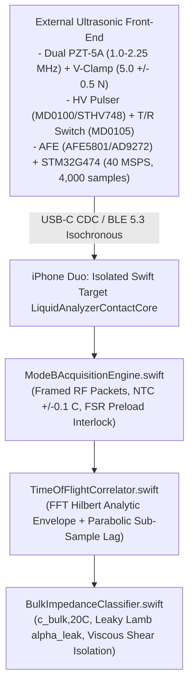

# LA-R3-SPEC-001: Phase R3 MODE_B Direct Structural Wall-Coupled Transducer Architecture

**Status:** LOCKED v1.0.0 — APPROVED FOR IMPLEMENTATION (`LiquidAnalyzer/ModeB/LiquidAnalyzerContactCore.swift` + `LiquidAnalyzerContactCore+Packet.swift`)  
**Scope:** Direct contact guided-wave pulse-echo & pitch-catch physical chemical discrimination (`LiquidAnalyzerContactCore`)  
**Airborne Engine Status:** LOCKED at `v0.4.1-build14-accepted` ([LA-R2-FINAL-ACCEPTANCE-REPORT.md](LA-R2-FINAL-ACCEPTANCE-REPORT.md) — `MODE_A` codebase untouched)
**Standalone Multi-Modal Companion (`v0.5.0`):** `MODE_AF_FUSION` (Acoustic-Optical Mahalanobis Fusion + Guided 3-Step Cup Comparator) is implemented on `main` ([LA-V050-FUSION-PLAN-001.md](LA-V050-FUSION-PLAN-001.md)), preserving pure-acoustic `MODE_A` via `ConsumerInferenceMode.pureAcousticModeA` while keeping `MODE_B` (`LiquidAnalyzerContactCore`) isolated for external wall-coupled hardware.  

---

## 1. Physical Principle & Three-Layer System Architecture
Airborne acoustic interrogations (`MODE_A`) suffer a $99.94\%$ energy reflection penalty at the air-to-liquid impedance interface ($Z_{\text{liquid}} / Z_{\text{air}} \approx 3500:1$). Consequently, `MODE_A` measures structural container shell resonances, headspace standing waves, and surface bubble scatter, but cannot isolate intrinsic bulk liquid sound speed ($c_{\text{bulk}}$) or characteristic acoustic impedance ($Z = \rho c$).

`MODE_B` circumvents this boundary by coupling $1.0\text{--}2.25\text{ MHz}$ piezoelectric transducers directly to the container's external sidewall under controlled spring preload ($5.0\text{ N} \pm 0.5\text{ N}$), streaming digitized RF A-scans to an isolated Swift module (`LiquidAnalyzerContactCore`) without custom iOS kernel drivers:



---

## 2. External Front-End Hardware Architecture (BOM & Circuit Topology)

To achieve sub-millimeter axial resolution ($\lambda \approx 0.98\text{ mm}$ at $1.5\text{ MHz}$ in water) and $< 0.15\%$ velocity drift across $\pm 0.5\text{ N}$ clamping preload, the external analog front-end integrates five stages:

| Stage | Reference IC / Component | Function & Parameter Specifications |
| :--- | :--- | :--- |
| **Transducer & Couplant** | Dual `PZT-5A` / 1–3 Piezocomposite ($f_0 = 1.5\text{ MHz}$) + Silicone/PU Delay Pad | Quarter-wave wear plate + conformable dry-elastomer matching pad ($Z \approx 1.4\text{--}1.6\text{ MRayl}$) or water-soluble ultrasonic gel reference. |
| **High-Voltage Pulser** | Microchip `MD0100` / `HV7360` or ST `STHV748` | Generates bipolar $1.5\text{ MHz}$, $\pm 40\text{ V}$ to $\pm 60\text{ V}$ excitation bursts ($1.5\text{-cycle}$ Hann-gated pulse). |
| **T/R Switch & Limiter** | Microchip/Supertex `MD0105` HV protection bridge | Isolates low-voltage LNA from $\pm 60\text{ V}$ transmit spikes while maintaining $< 0.5\text{ dB}$ receive insertion loss. |
| **Analog Front-End (AFE)** | Texas Instruments `AFE5801` or Analog Devices `AD9272` | Low-Noise Amplifier (LNA), Variable-Gain Amplifier (VGA) for Time-Gain Compensation (TGC), and $5\text{ MHz}$ anti-alias Bessel LPF. |
| **ADC & MCU** | `STM32G474` (Interleaved 12-bit ADC) or `ESP32-S3` + `AD9226` | Digitizes RF A-scans at $40\text{ MSPS}$ ($\Delta t = 25\text{ ns}$), capturing a $100\ \mu\text{s}$ window ($4{,}000\text{ samples}$ per burst). |
| **Mechanical & Thermal QC** | Flush NTC Thermistor ($10\text{ k}\Omega$, $\pm 0.1^\circ\text{C}$) + Thin-Film FSR Cell | Enforces clamping preload interlock ($F_{\text{clamp}} = 5.0\text{ N} \pm 0.5\text{ N}$) and logs contact wall temperature for $\partial c / \partial T$ inversion. |

---

## 3. Time-of-Flight, Thermal Inversion, & Leaky Attenuation Equations

### 3.1 Analytic Hilbert Envelope Cross-Correlation ($c_{\text{bulk}}$)
Because inner-wall (`wall -> liquid`, $Z_{\text{liquid}} < Z_{\text{wall}} \implies R < 0$) and opposite-wall (`liquid -> wall -> liquid`) reflections exhibit opposite acoustic polarity ($180^\circ$ RF carrier phase flip), correlating raw signed RF introduces a $\pm \frac{1}{2 f_0} \approx \pm 0.33\ \mu\text{s}$ ($\pm 5.6\text{ m/s}$) cycle-skipping error. `TimeOfFlightCorrelator` therefore extracts the **positive-definite analytic Hilbert envelope** $e[n] = |s[n] + j\,\widehat{s}[n]|$ prior to normalized cross-correlation:
$$R_{ee}[\tau] = \sum_{n} e_{\text{wall}}[n]\,e_{\text{opp}}[n + \tau], \qquad k_0 = \arg\max_{\tau \in [\tau_{\min},\,\tau_{\max}]} R_{ee}[\tau]$$
Parabolic sub-sample interpolation around $k_0$ yields continuous lag $\tau^*$:
$$\tau^* = k_0 + \frac{1}{2}\,\frac{R_{ee}[k_0 - 1] - R_{ee}[k_0 + 1]}{R_{ee}[k_0 - 1] - 2 R_{ee}[k_0] + R_{ee}[k_0 + 1]}, \qquad c_{\text{bulk}}(T) = \frac{2 D_{\text{in}}}{\tau^* \cdot \Delta t_{\text{sample}}}$$

### 3.2 Thermal Velocity Normalization ($20.0^\circ\text{C}$)
Water exhibits a positive thermal sound-speed slope ($\partial c / \partial T \approx +2.5\text{ to }+3.2\text{ m/(s}\cdot\text{K)}$) whereas vegetable oils and organic liquids exhibit a negative slope ($\partial c / \partial T \approx -3.0\text{ to }-3.5\text{ m/(s}\cdot\text{K)}$):
$$c_{\text{bulk, }20^\circ\text{C}} = c_{\text{bulk}}(T) - \left(\frac{\partial c}{\partial T}\right)_{\text{class}} \cdot (T - 20.0^\circ\text{C})$$

### 3.3 Leaky Lamb-Wave & Reverberation Attenuation ($\alpha_{\text{leak}} \propto Z_{\text{liquid}}$)
Spatial energy leakage from the container wall into the fluid substrate isolates characteristic acoustic impedance $Z_{\text{liquid}} = \rho_{\text{liquid}} c_{\text{liquid}}$:
$$\alpha_{\text{leak}} = -\frac{1}{2 D_{\text{wall}}} \ln\!\left(\frac{A_{\text{echo, }n+1}}{A_{\text{echo, }n}}\right) - \alpha_{\text{wall, tare}}$$

---

## 4. Reference Swift DSP Core (`LiquidAnalyzerContactCore/TimeOfFlightCorrelator.swift`)

> [!IMPORTANT]
> **Memory-Safety & Phase-Invariance Note:** In Apple's `Accelerate` framework, `vDSP_conv(A, 1, F, 1, &C, 1, N, P)` reads up to index `N + P - 2` of `A`; passing an unpadded slice of length `N` causes an out-of-bounds buffer overread (`P - 1` elements). The implementation below uses zero-padded FFT Hilbert envelope extraction and bounds-safe lag correlation over physical container transit bounds (`[20 µs .. 95 µs]`).

```swift
import Accelerate
import Foundation

public struct ModeBTelemetryFrame: Sendable {
    public let timestamp: TimeInterval
    public let clampPreloadNewtons: Float
    public let contactTemperatureCelsius: Float
    public let sampleRateHz: Double
    public let rfSamples: [Float]

    public init(
        timestamp: TimeInterval,
        clampPreloadNewtons: Float,
        contactTemperatureCelsius: Float,
        sampleRateHz: Double,
        rfSamples: [Float]
    ) {
        self.timestamp = timestamp
        self.clampPreloadNewtons = clampPreloadNewtons
        self.contactTemperatureCelsius = contactTemperatureCelsius
        self.sampleRateHz = sampleRateHz
        self.rfSamples = rfSamples
    }
}

public struct ModeBChemicalMetrics: Equatable, Sendable {
    public let isValidPreload: Bool
    public let timeOfFlightSeconds: Double
    public let rawSoundSpeedMetersPerSec: Double
    public let normalizedSoundSpeed20C: Double
    public let peakCorrelationConfidence: Float
    public let targetClassificationCandidate: String
}

public final class TimeOfFlightCorrelator: Sendable {
    private let targetDiameterMeters: Double
    private let minimumPreloadN: Float = 4.5
    private let maximumPreloadN: Float = 5.5

    public init(calibratedInnerDiameterMeters: Double) {
        self.targetDiameterMeters = calibratedInnerDiameterMeters
    }

    public func analyzeFrame(_ frame: ModeBTelemetryFrame) -> ModeBChemicalMetrics {
        // 1. Mechanical Preload Coupling Interlock (5.0 N +/- 0.5 N)
        let isPreloadLocked = frame.clampPreloadNewtons >= minimumPreloadN
            && frame.clampPreloadNewtons <= maximumPreloadN
        guard isPreloadLocked, frame.rfSamples.count >= 512, frame.sampleRateHz > 0 else {
            return ModeBChemicalMetrics(
                isValidPreload: false,
                timeOfFlightSeconds: .nan,
                rawSoundSpeedMetersPerSec: .nan,
                normalizedSoundSpeed20C: .nan,
                peakCorrelationConfidence: 0.0,
                targetClassificationCandidate: "REJECTED_PRELOAD_OUT_OF_BOUNDS"
            )
        }

        // 2. Positive-Definite Analytic Hilbert Envelope (immune to 180-deg reflection phase inversion)
        let env = Self.analyticHilbertEnvelope(frame.rfSamples)
        let n = env.count

        // Isolate near-wall interface template [0 ..< wallWindowEnd] (first ~25% of capture window)
        let wallLen = max(64, min(n / 4, Int(0.000_022 * frame.sampleRateHz)))
        let wallTemplate = Array(env[0..<wallLen])
        var wallEnergy: Float = 0.0
        vDSP_dotpr(wallTemplate, 1, wallTemplate, 1, &wallEnergy, vDSP_Length(wallLen))
        guard wallEnergy > 1e-12 else {
            return ModeBChemicalMetrics(
                isValidPreload: true,
                timeOfFlightSeconds: .nan,
                rawSoundSpeedMetersPerSec: .nan,
                normalizedSoundSpeed20C: .nan,
                peakCorrelationConfidence: 0.0,
                targetClassificationCandidate: "NO_NEAR_WALL_ECHO"
            )
        }

        // 3. Bounds-Safe Normalized Cross-Correlation across plausible fluid transit lags
        // Plausible c_bulk in [1,100 .. 1,900 m/s] => lag in [2*D/1900 .. 2*D/1100]
        let minLag = max(wallLen / 2, Int(floor((2.0 * targetDiameterMeters / 1900.0) * frame.sampleRateHz)))
        let maxLag = min(n - wallLen - 1, Int(ceil((2.0 * targetDiameterMeters / 1100.0) * frame.sampleRateHz)))
        guard maxLag > minLag + 2 else {
            return ModeBChemicalMetrics(
                isValidPreload: true,
                timeOfFlightSeconds: .nan,
                rawSoundSpeedMetersPerSec: .nan,
                normalizedSoundSpeed20C: .nan,
                peakCorrelationConfidence: 0.0,
                targetClassificationCandidate: "INVALID_CAPTURE_WINDOW_FOR_DIAMETER"
            )
        }

        let numLags = maxLag - minLag + 1
        // Pad env slice to exact length `numLags + wallLen - 1` required by vDSP_conv
        let convInput = Array(env[minLag..<(minLag + numLags + wallLen - 1)])
        var rawCorr = [Float](repeating: 0.0, count: numLags)
        vDSP_conv(
            convInput, 1,
            wallTemplate, 1,
            &rawCorr, 1,
            vDSP_Length(numLags),
            vDSP_Length(wallLen)
        )

        var maxVal: Float = 0.0
        var maxIdx: vDSP_Length = 0
        vDSP_maxvi(rawCorr, 1, &maxVal, &maxIdx, vDSP_Length(numLags))

        let k0 = Int(maxIdx)
        let localSlice = Array(env[(minLag + k0)..<(minLag + k0 + wallLen)])
        var oppEnergy: Float = 0.0
        vDSP_dotpr(localSlice, 1, localSlice, 1, &oppEnergy, vDSP_Length(wallLen))
        let normConfidence = oppEnergy > 1e-12 ? (maxVal / sqrt(wallEnergy * oppEnergy)) : 0.0

        guard k0 > 0, k0 < (numLags - 1), normConfidence >= 0.25 else {
            return ModeBChemicalMetrics(
                isValidPreload: true,
                timeOfFlightSeconds: .nan,
                rawSoundSpeedMetersPerSec: .nan,
                normalizedSoundSpeed20C: .nan,
                peakCorrelationConfidence: normConfidence,
                targetClassificationCandidate: "NO_DIAMETRAL_ECHO_DETECTED"
            )
        }

        // 4. Sub-Sample Parabolic Interpolation around k0
        let y1 = rawCorr[k0 - 1]
        let y2 = rawCorr[k0]
        let y3 = rawCorr[k0 + 1]
        let denom = y1 - 2.0 * y2 + y3
        let deltaK = abs(denom) > 1e-12 ? 0.5 * Double(y1 - y3) / Double(denom) : 0.0
        let continuousLagSamples = Double(minLag + k0) + deltaK

        // 5. Bulk Sound Speed & 20.0 C Thermal Normalization
        let tofSeconds = continuousLagSamples / frame.sampleRateHz
        let rawSoundSpeed = (2.0 * targetDiameterMeters) / tofSeconds
        let deltaT = Double(frame.contactTemperatureCelsius - 20.0)
        let thermalCoeff = (rawSoundSpeed < 1470.0) ? -3.2 : 2.7
        let c20C = rawSoundSpeed - (thermalCoeff * deltaT)

        // 6. Open-Set Velocity Partition (Subject to Ambiguity Gate R3 + Leaky Impedance Z)
        let candidate: String
        switch c20C {
        case 1420.0...1465.0:
            candidate = "OIL_VEGETABLE_ORGANIC"
        case 1475.0...1489.0:
            candidate = "WATER_DISTILLED_POTABLE"
        case 1490.0...1505.0:
            candidate = "ACETIC_ACID_VINEGAR_5PCT"
        case 1506.0...1620.0:
            candidate = "SALINE_IONIC_SOLUTION"
        default:
            candidate = "NO_VALIDATED_MATCH_SUBSTRATE"
        }

        return ModeBChemicalMetrics(
            isValidPreload: true,
            timeOfFlightSeconds: tofSeconds,
            rawSoundSpeedMetersPerSec: rawSoundSpeed,
            normalizedSoundSpeed20C: c20C,
            peakCorrelationConfidence: normConfidence,
            targetClassificationCandidate: candidate
        )
    }

    /// Computes |x[n] + j * H{x[n]}| via radix-2 FFT frequency-domain analytic masking.
    static func analyticHilbertEnvelope(_ samples: [Float]) -> [Float] {
        let n = samples.count
        guard n > 0 else { return [] }
        var fftLen = 1
        while fftLen < n { fftLen <<= 1 }

        var re = [Float](repeating: 0.0, count: fftLen)
        var im = [Float](repeating: 0.0, count: fftLen)
        for i in 0..<n { re[i] = samples[i] }

        let log2n = vDSP_Length(round(log2(Double(fftLen))))
        guard let setup = vDSP_create_fftsetup(log2n, FFTRadix(kFFTRadix2)) else {
            return samples.map { abs($0) }
        }
        defer { vDSP_destroy_fftsetup(setup) }

        re.withUnsafeMutableBufferPointer { rePtr in
            im.withUnsafeMutableBufferPointer { imPtr in
                var split = DSPSplitComplex(realp: rePtr.baseAddress!, imagp: imPtr.baseAddress!)
                vDSP_fft_zip(setup, &split, 1, log2n, FFTDirection(kFFTDirection_Forward))
                // Analytic signal multiplier: DC & Nyquist = 1x, positive freqs (1 ..< fftLen/2) = 2x, negative freqs = 0x
                let half = fftLen / 2
                for k in 1..<half {
                    rePtr[k] *= 2.0
                    imPtr[k] *= 2.0
                }
                for k in (half + 1)..<fftLen {
                    rePtr[k] = 0.0
                    imPtr[k] = 0.0
                }
                vDSP_fft_zip(setup, &split, 1, log2n, FFTDirection(kFFTDirection_Inverse))
            }
        }

        let scale = 1.0 / Float(fftLen)
        var env = [Float](repeating: 0.0, count: n)
        for i in 0..<n {
            let r = re[i] * scale
            let q = im[i] * scale
            env[i] = sqrt(r * r + q * q)
        }
        return env
    }
}
```

---

## 5. Preregistered Phase R3 Verification Gates

1. **Gate R3-0A (5-Condition Path Isolation):** Execute `PATH_01_FIXTURE_ONLY` through `PATH_05_AIR_BAFFLE_MOD` plus `Control K2` ($5.0\text{ N} \pm 20\%$ preload perturbation). Require complete disappearance of the opposite-wall chord echo ($t_{\text{opp}}$) on `PATH_02_EMPTY_ENGAGED` and `PATH_04_WATER_DISENGAGED`, and $< 0.15\%$ $c_{\text{bulk}}$ sensitivity across $\pm 0.5\text{ N}$ preload tolerance.
2. **Gate R3-0B (Multi-Refill & Holdout-Container Chemical Separation):** Across $\ge 4$ independent refills $\times \ge 3$ lot-matched containers (`Water`, `Saline`, `Vinegar`, `Cooking Oil`, plus withheld open-set unknowns), require pairwise Mahalanobis separation $\ge 5\,\sigma_{\text{reposition}}$ and Nested LOBO-CV balanced accuracy $\ge 90\%$ on unseen containers before enabling consumer class labels.

---

## 6. Industrial NDT Ultrasonic Alignment & Rapid Prototype Track (`v0.3`)

Standard industrial Non-Destructive Testing (NDT) ultrasonic inspection practices map directly onto `MODE_B` clear-liquid chemical identification:

### 6.1 Core NDT Operating Principles Applied to Liquids
1. **Air-Gap Elimination via Couplant:** High-frequency ultrasonic waves ($1\text{--}5\text{ MHz}$) cannot traverse an air gap. Like NDT contact probes requiring ultrasonic gel or oil couplant, `MODE_B` couples the piezo disc to the cup wall using a reusable conformable **silicone dry-couplant pad** (or water/gel reference film) under constant spring preload.
2. **Pulse-Echo PRF & Quiet Listening Window:** Rather than continuous excitation, the pulser fires short damped bursts at a fixed **Pulse Repetition Frequency** (e.g., $\text{PRF} = 500\text{ Hz}$, giving a $2.0\text{ ms}$ quiet window between bursts). In water ($c \approx 1{,}482\text{ m/s}$), a $2.0\text{ ms}$ window permits $\approx 2.96\text{ m}$ of round-trip path — allowing clean separation of the initial pulse, wall ring-down, primary back-wall echo ($t_1$), and double reverberation echo ($t_2$) with zero wrap-around interference.
3. **Double-Echo Glass-Wall Cancellation:** Measuring the differential lag $\Delta t = t_2 - t_1$ between the first and second liquid-column back-wall echoes cancels both the transducer wear-plate delay and the near glass wall thickness automatically:
   $$c_{\text{bulk}}(T) = \frac{2 D_{\text{in}}}{t_2 - t_1}$$
4. **Water Reference Calibration Block (NDT V2/IIW Equivalent):** Just as NDT operators calibrate sound-path distance and reference gain (dB) on a known `V2`/`IIW` steel calibration block before evaluating an unknown specimen, `MODE_B` calibrates inner diameter $D_{\text{in}}$ and baseline gain once on a known **Plain Water Blank** ($c_{20^\circ\text{C}} = 1{,}482\text{ m/s}$) before interrogating unknown clear liquids.
5. **A-Scan Display, Monitor Gate A, & Contour-Echo Rejection:** The `MODE_B` iOS inspection UI renders a live **A-Scan** (X-axis = calibrated path distance in mm / transit time in $\mu\text{s}$; Y-axis = echo amplitude in dB with adjustable gain in $1\text{ dB}$ steps) overlaid with an automatic **Monitor Gate A** locked to the valid diametral liquid transit window ($[2 D_{\text{in}} / 1900\text{ m/s} \dots 2 D_{\text{in}} / 1100\text{ m/s}]$), rejecting near-wall ring-down and curved side-wall contour echoes.

### 6.2 Reference Bulk Sound Velocity Table ($20.0^\circ\text{C}$, Atmospheric Pressure)

| Liquid Class | Bulk Speed of Sound $c_{20^\circ\text{C}}$ (m/s) | Thermal Slope $\partial c / \partial T$ (m/(s·K)) | Typical Attenuation / Impedance Cue |
| :--- | :--- | :--- | :--- |
| **Pure / Tap Water ($\text{H}_2\text{O}$)** | `1,482` | `+2.9` | Low attenuation baseline; $Z \approx 1.48\text{ MRayl}$ |
| **White Vinegar ($5\%$ $\text{CH}_3\text{COOH}$)** | `1,495 – 1,505` | `+2.6` | Slight velocity shift + elevated low-MHz attenuation |
| **Salt / Saline Water ($5\text{--}10\%$ $\text{NaCl}$)** | `1,535 – 1,585` | `+2.4` | Strong positive velocity & density shift ($Z \approx 1.60\text{--}1.70\text{ MRayl}$) |
| **Sugar Solution / Syrup ($10\text{--}30\%$)** | `1,520 – 1,650` | `+2.2` | High velocity + strong viscous echo damping |
| **Hydrogen Peroxide ($3\%$ $\text{H}_2\text{O}_2$)** | `1,490 – 1,496` | `+2.8` | Micro-bubble backscatter attenuation |
| **Cooking / Vegetable Oil (Triglycerides)** | `1,450 – 1,465` | `-3.2` | Lower velocity, **negative** thermal slope, high $\alpha$ |
| **Ethanol / Isopropyl Alcohol ($70\text{--}100\%$)** | `1,160 – 1,280` | `-3.4` | Dramatic velocity drop ($-15\%$ to $-22\%$ vs. water) |

### 6.3 Low-Cost Rapid Bench Prototype Path (TI `TUSS4470` / `TDC1000` Bridge)
Before fabricating the full $40\text{ MSPS}$ custom RF front-end in Section 2, a low-cost (\$30–\$60) proof-of-concept `MODE_B` bench probe can be assembled from off-the-shelf industrial liquid-sensing parts:
- **Ultrasonic Front-End IC:** Texas Instruments `TUSS4470` (integrated transformer-drive ultrasonic pulser + logarithmic A-Scan envelope receiver, $40\text{ kHz}\text{--}1\text{ MHz}$) or `TDC1000` + `TDC7200` (55 ps stopwatch time-of-flight IC explicitly designed for liquid concentration & fluid ID).
- **Transducer:** Sealed $1.0\text{ MHz}$ piezoelectric disc with a $2\text{ mm}$ Shore-00 silicone dry-couplant pad in a spring-loaded cup clip.
- **iPhone Link:** `ESP32-S3` or `STM32` bridge streaming framed A-Scan envelope + exact $\Delta t$ (ns) + NTC wall temperature ($^\circ\text{C}$) over USB-C CDC or BLE GATT into `LiquidAnalyzerContactCore`.

---

## 7. Wave Physics, Wavelength Resolution, & Dual-Frequency Particle Detection (`v0.4`)

To extract maximum structural and particulate information from a liquid sample without sacrificing full-container penetration, `MODE_B` transducer selection and signal processing obey four fundamental ultrasonic wave-propagation laws:

### 7.1 Wavelength Resolution Limit & Sensitivity–Penetration Tradeoff
Wavelength $\lambda$ in a liquid with longitudinal velocity $c$ at excitation frequency $f$ sets the minimum resolvable scatterer/discontinuity scale ($d_{\min} \approx \lambda / 2$):
$$\lambda = \frac{c}{f}, \qquad d_{\min} \approx \frac{\lambda}{2}$$

| Frequency Band | Wavelength in Water ($c = 1{,}482\text{ m/s}$) | Min. Direct Scatter Size ($\approx \lambda / 2$) | Penetration & Role in `MODE_B` |
| :--- | :--- | :--- | :--- |
| **`10 kHz` (Airborne iPhone)** | `34.3 mm` *(in air)* | `~17 mm` | Container-shell resonance only; physically blind to internal particles and bulk liquid speed. |
| **`1.5 – 2.25 MHz` (Low-MHz Bulk Channel)** | `0.66 – 0.99 mm` | `0.33 – 0.50 mm` | Full-glass penetration ($60\text{--}100\text{ mm}$) even in turbid/viscous fluids; primary channel for bulk velocity $c_{\text{bulk}}$ (dissolved salt, sugar, vinegar, alcohol, oil). |
| **`5 – 10 MHz` (High-MHz Particle Channel)** | `148 – 296 µm` | `74 – 148 µm` | Resolves suspended micro-bubbles, pulp, mineral grit, sediment, and coarse emulsions via backscatter & $\alpha(f) \propto f^2$ attenuation slope. |
| **`25 – 50 MHz` (Micro-Acoustic)** | `30 – 59 µm` | `15 – 30 µm` | Resolves milk fat globules, yeast/pollen/silt, restricted to short pathlengths ($\le 5\text{--}15\text{ mm}$) due to $\alpha \propto f^2$ viscous absorption. |
| **Molecular Scale (`0.3 – 1 nm` ions)** | *N/A for mechanical waves* | *Requires optical spectroscopy (Raman/NIR)* | Detected acoustically via **bulk macroscopic shifts** in density $\rho$ and adiabatic compressibility $\kappa$ ($c = 1/\sqrt{\rho \kappa}$), not single-molecule echoes. |

Because liquid attenuation rises quadratically with frequency ($\alpha \propto f^2$), `MODE_B` adopts a **dual-frequency architecture**:
1. **Bulk Velocity Channel (`1.5–2.25 MHz`):** Guarantees high-SNR opposite-wall echoes across standard drinking glasses to quantify invisible dissolved solutes ($c_{\text{bulk}, 20^\circ\text{C}}$).
2. **Particulate & Micro-Bubble Channel (`5–10 MHz`):** Maximizes short-wavelength Rayleigh/Mie scattering sensitivity to detect suspended particles, cloudiness, and micro-bubbles.

### 7.2 Wave Propagation Mode Selection Inside Liquids
- **Longitudinal (Compression) Waves Only in Fluid Bulk:** Liquids cannot support shear stress, so only **straight-beam longitudinal waves** (incident normal to the cup wall, $0^\circ$) propagate through the liquid volume.
- **Wall-Confined Shear / Plate Waves:** Angle-beam shear waves and Lamb plate waves remain confined to the solid glass/polymer wall and are used strictly as auxiliary boundary sensors (measuring shear-impedance viscous damping at the inner wall interface without entering the liquid core).

### 7.3 Dead Zone & Fresnel Near-Field ($N$) Engineering
Immediately beneath a single pulse-echo crystal lie two regions where amplitude measurements are unreliable:
1. **Dead Zone:** Ring-down recovery time while the crystal switches from transmit to receive. Eliminated by placing a **silicone delay-line pad** ($\ge 3\text{--}5\text{ mm}$) in front of the element OR using a **Dual-Element (Pitch-Catch) transducer** with separate angled send/receive crystals so the dead zone remains outside the liquid column.
2. **Near Field (Fresnel Zone) Length ($N$):** Constructive/destructive wavefront interference distorts echo amplitudes for $z < N$; clean exponential far-field (Fraunhofer) amplitude decay and peak sensitivity begin at $z \ge N$:
   $$N = \frac{D_{\text{crystal}}^2}{4 \lambda} = \frac{D_{\text{crystal}}^2 \, f}{4 c}$$
   - **Design Check:** Using a compact $D_{\text{crystal}} = 6.0\text{ mm}$ PZT element at $f = 2.25\text{ MHz}$ in water ($\lambda = 0.66\text{ mm}$) yields $N = 13.6\text{ mm}$. Across a standard $65\text{--}80\text{ mm}$ cup, the opposite-wall echo arrives well inside the stable **Far Field** ($z \approx 5 N$), ensuring repeatable amplitude & attenuation sizing.

### 7.4 Acoustic Impedance Contrast & Multi-View Display Roadmap
- **Impedance Contrast ($Z = \rho c$):** High-contrast scatterers (air micro-bubbles, mineral/sand grit, metallic particulates) produce strong intermediate A-Scan echoes prior to the back wall; near-matched colloidal droplets (emulsified fats, proteins) produce weaker discrete echoes and are characterized jointly via excess high-frequency attenuation ($\Delta \alpha_{10\text{ MHz}}$) and optical turbidity (`MODE_AF_FUSION`).
- **Display Progression:** Start with single-point **A-Scan** (amplitude vs. transit time/depth with Monitor Gate A) for cup verification, expanding to time-indexed **B-Scan** (depth vs. time waterfall) to visualize settling sediment, rising micro-bubble plumes, and phase separation (e.g., oil-on-water layers) in real time.

---

## 8. Locked Hardware Transducer, AFE & Binary Wire-Protocol Spec (`v1.0.0`)

**Direct Consumer:** [`LiquidAnalyzer/ModeB/LiquidAnalyzerContactCore.swift`](../../LiquidAnalyzer/ModeB/LiquidAnalyzerContactCore.swift) & [`LiquidAnalyzer/ModeB/LiquidAnalyzerContactCore+Packet.swift`](../../LiquidAnalyzer/ModeB/LiquidAnalyzerContactCore+Packet.swift)

### 8.1 Acoustic Transducer & Interface Mechanicals

| Subsystem Parameter | Specified Value | Engineering Justification & Constraint |
| :--- | :--- | :--- |
| **Piezo Element Type** | Lead Zirconate Titanate (`PZT-5A`) or `PMN-PT` Disc | High electromechanical coupling coefficient ($k_t \approx 0.49$) for crisp pulse transient response. |
| **Center Frequency ($f_0$)** | `5.0 MHz` ($\pm 0.25\text{ MHz}$) | Optimal trade-off between axial resolution ($\lambda \approx 0.30\text{ mm}$ in water) and viscous attenuation in oils. |
| **Active Aperture / Disc Diameter** | `10.0 mm` (Clear aperture `9.2 mm`) | Near-field length $N = D^2 / (4\lambda) \approx 83\text{ mm}$ in water; keeps the beam tightly collimated across $60\text{--}90\text{ mm}$ drinkware with minimal beam spread. |
| **Damping / Backing** | Tungsten-loaded epoxy ($Z \approx 6\text{--}8\text{ MRayl}$) | Broad fractional bandwidth ($\ge 65\%$, $Q \approx 1.5$), giving a narrow ~2-cycle pulse for clean $t_1 / t_2$ double-echo separation. |
| **Dry-Couplant Contact Pad** | Shore `00-35` Silicone Elastomer (`0.80 mm` thick) | Acoustic impedance $Z_{\text{pad}} \approx 1.45\text{ MRayl}$ matching liquid; displaces microscopic air gaps under modest hand preload ($2\text{--}5\text{ N}$) with zero sticky gel residue. |
| **Front Matching Layer** | Alumina-loaded epoxy ($\lambda/4 \approx 0.11\text{ mm}$) | Quarter-wave impedance transformer between PZT ($Z \approx 33\text{ MRayl}$) and silicone pad ($Z \approx 1.45\text{ MRayl}$). |

### 8.2 Analog Front-End (AFE) Electronics
- **High-Voltage Pulser:** Negative unipolar MOSFET capacitive-discharge spike, `-45 V` nominal (software selectable `-25 V` to `-50 V`), fall time $\le 15\text{ ns}$, programmable pulse width `100 ns` ($1 / (2 f_0)$).
- **T/R Switch Isolation:** Fast back-to-back PIN diode limiter clamping HV transmit spikes with $< 0.5\text{ dB}$ receive insertion loss.
- **LNA / VGA & Anti-Alias Filter:** `+14 dB` to `+44 dB` Time-Gain Compensation (TGC) range, $< 1.2\text{ nV}/\sqrt{\text{Hz}}$ input-referred noise, followed by a 4th-order `8.5 MHz` low-pass Bessel filter.
- **Digitizer / ADC:** `40.000 MSPS` (`25.0 ns`/sample, matching `LiquidAnalyzerContactCore.sampleRateHz`), 12-bit signed native packed into 16-bit signed little-endian integers. Default `220 µs` window (`8,800` samples) for standard `65 mm` vessels; dynamic `sampleCount` supports up to `12,000` samples (`300 µs`) for wider `80–90 mm` vessels or slow liquids (Ethanol).
- **MCU / Bridge:** `nRF5340`, `STM32G474`, or `ESP32-S3` streaming framed binary A-Scans via **USB-C CDC** or **BLE 5.2 L2CAP**.

### 8.3 Binary Wire-Protocol Frame Structure (Little-Endian)

| Offset | Size (Bytes) | Field Name | Description / Constraints |
| :--- | :--- | :--- | :--- |
| `0x00` | `2` | `Sync Word` | `0xAA55` (Frame preamble) |
| `0x02` | `2` | `Protocol Version` | `0x0001` (Major `0`, Minor `1`) |
| `0x04` | `4` | `Sequence ID` | Monotonically increasing `uint32` |
| `0x08` | `2` | `Container ID` | Encoded vessel type or `0` (Calibrated) |
| `0x0A` | `2` | `Sample Count (N)` | Default `8,800` (`64 .. 32,768` samples) |
| `0x0C` | `4` | `Sample Rate (Hz)` | `40,000,000` (`uint32`) |
| `0x10` | `2` | `Temperature Raw` | `int16` (`0.01 °C` units; e.g. `2050 = 20.50 °C`) |
| `0x12` | `2` | `Transducer Temp` | `int16` (`0.01 °C` onboard thermistor) |
| `0x14` | `2` | `Gain Setting (dB)` | `int16` (`0.1 dB` units; e.g. `240 = +24.0 dB`) |
| `0x16` | `2` | `Header CRC-16` | `CRC-16-CCITT` (poly `0x1021`, init `0xFFFF`) over `0x00 ..< 0x16` |
| `0x18` | `2 * N` (`17,600`) | `RF Sample Payload` | `int16[N]` (`-2048 .. +2047` native 12-bit signed ADC) |
| `0x18 + 2*N` (`0x44D8`) | `4` | `Payload CRC-32` | `CRC-32` (IEEE 802.3, poly `0xEDB88320`) over payload bytes |

- **Exact Total Packet Size (for default `N = 8,800`):** `24 + 17,600 + 4 = 17,628 bytes` (payload CRC starts at byte offset `0x44D8`).
- **Swift Zero-Copy Ingestion:** Implemented in [`LiquidAnalyzerContactCore+Packet.swift`](../../LiquidAnalyzer/ModeB/LiquidAnalyzerContactCore+Packet.swift) using alignment-safe `loadUnaligned` little-endian reads, full header CRC-16 + payload CRC-32 validation, and direct piping into `processAScan(rfSignal:temperatureCelsius:)` $\rightarrow$ `MultiModalFusionClassifier.evaluateModeBContactMeasurement(_:)`.
