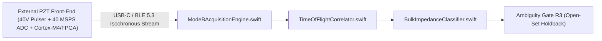

# LA-R3-SPEC-001: Phase R3 MODE_B Direct Structural Wall-Coupled Transducer Architecture

**Status:** DRAFT FOR ARCHITECTURAL REVIEW  
**Scope:** Direct contact guided-wave pulse-echo & pitch-catch physical chemical discrimination  
**Airborne Engine Status:** LOCKED at `v0.4.1` ([LA-R2-FINAL-ACCEPTANCE-REPORT.md](LA-R2-FINAL-ACCEPTANCE-REPORT.md) — `MODE_A` codebase untouched)  

---

## 1. Physical Principle & Need
Airborne acoustic interrogations (`MODE_A`) suffer a $99.94\%$ energy reflection penalty at the air-to-liquid impedance interface ($Z_{\text{liquid}} / Z_{\text{air}} \approx 3500:1$). Consequently, `MODE_A` measures structural container shell resonances, headspace standing waves, and surface bubble scatter, but cannot isolate bulk liquid sound speed ($c_{\text{bulk}}$) or shear/longitudinal acoustic impedance ($Z = \rho c$).

`MODE_B` circumvents this airborne boundary by acoustically coupling ultrasonic piezoelectric transducers directly to the container's external sidewall below the liquid meniscus, transmitting elastic stress waves (antisymmetric/symmetric Lamb waves and longitudinal/shear bulk pulses) across the solid–fluid boundary.

```text
   [MODE_B Structural Pulse-Echo / Pitch-Catch Concept]

    +---------------- Container Wall ----------------+
    |                                                |
[PZT Tx] ===== Elastic Wave Propagation =====> [PZT Rx]
(Pulse)  \         (Leaky Lamb Wave)          / (Echo)
          \                                  /
           \  Leaky Longitudinal Bulk       /
            \ Wave Radiation into Fluid    /
             \                            /
              \        Fluid Bulk        /
               \  (Speed c, Viscosity η)/
                v                      v
```

---

## 2. Transducer & Hardware Subsystem Requirements

### 2.1 Acoustic Transducer Selection
* **Primary Pulse-Echo / Leaky-Lamb Band:** $1.0\text{ MHz}$ to $2.25\text{ MHz}$ center frequency ($f_0$).
  * *Rationale:* Wavelength in water ($\lambda = c/f \approx 1480\text{ m/s} / 1.5\text{ MHz} \approx 0.98\text{ mm}$) provides sub-millimeter axial resolution across standard container diameters ($50\text{--}90\text{ mm}$) without excessive bulk path attenuation.
* **Transducer Elements:**
  * Dual-element Lead Zirconate Titanate (`PZT-5A`) or 1–3 piezocomposite crystals with quarter-wave polymer wear plate.
  * Configuration: Pitch-catch V-mount wedge (angled near the $A_0$ coincidence angle) or single-element normal-beam contact pulse-echo probe positioned strictly below the liquid meniscus ($\ge 15\text{ mm}$ above container base fillet).
* **Flush Contact Thermistor (`±0.1 °C`):** Integrated NTC/PT1000 sensor at the transducer shoe face to compensate opposite thermal velocity coefficients ($\partial c/\partial T \approx +3.0\text{ m/s}\cdot\text{K}^{-1}$ in water vs. $-3.2\text{ m/s}\cdot\text{K}^{-1}$ in oils).

### 2.2 Mechanical Fixturing & Coupling Control
* **Coupling Interface:** Conformable dry-elastomer delay line (low-durometer silicone/polyurethane acoustic impedance matching pad, $Z \approx 1.4\text{--}1.6\text{ MRayl}$) or water-soluble cross-linked ultrasonic couplant gel (gold-standard bench reference).
* **Clamping Assembly:** Self-centering spring-loaded caliper V-fixture ensuring constant normal contact preload:
  $$F_{\text{clamp}} = 5.0\text{ N} \pm 0.5\text{ N}$$
  *Rationale:* Eliminates manual contact-pressure variation (`Control K2`), which otherwise modulates interfacial transmission amplitude.
* **Hardware ID & Coupling Interlock:** Integrated preload microswitch plus electrical motional-admittance ($Y(f)$) check ensuring high-voltage pulse excitation fires only when solid couplant-to-wall acoustic loading is verified (`QC_COUPLING_LOCK`).

---

## 3. Signal Processing & Chemical Feature Extraction Pipeline

### 3.1 Pulse-Echo Time-of-Flight (Bulk Sound Speed $c_{\text{bulk}}$)
The transducer excites a $1.5$-cycle Hann-windowed ultrasonic pulse at $t = 0$. Cross-correlating the inner-wall interface echo ($t_{\text{wall}}$) against the opposite-wall diametral return echo ($t_{\text{opp}}$) yields round-trip fluid transit time:
$$t_{\text{TOF}} = t_{\text{opp}} - t_{\text{wall}}$$
Given calibrated vessel inner diameter $D_{\text{in}}$ (verified against a $20^\circ\text{C}$ distilled-water reference blank):
$$c_{\text{bulk}}(T) = \frac{2 D_{\text{in}}}{t_{\text{TOF}}}$$

*Representative Physical Discrimination ($20^\circ\text{C}$):*
* **Distilled Water:** $\approx 1482\text{ m/s}$ ($Z \approx 1.48\text{ MRayl}$)
* **5% Acetic Acid (Vinegar):** $\approx 1495\text{ m/s}$
* **Saline ($0.9\%\text{--}10\%\text{ NaCl}$):** $\approx 1493\text{--}1590\text{ m/s}$ (monotonic positive velocity & impedance shift)
* **Vegetable / Cooking Oil:** $\approx 1430\text{--}1465\text{ m/s}$ ($Z \approx 1.32\text{ MRayl}$, distinct negative velocity shift and negative $\partial c/\partial T$)

### 3.2 Leaky Lamb-Wave & Shear Boundary Attenuation (Impedance $Z$ & Viscosity $\eta$)
1. **Compressional Radiation Leakage ($Z_{\text{liquid}} = \rho c$):** A zero-order antisymmetric ($A_0$) Lamb wave excited along the container wall radiates compressional energy into the contacting liquid at the Rayleigh angle:
   $$\sin \theta_R = \frac{c_{\text{liquid}}}{c_{\text{Lamb}}}$$
   with spatial leakage attenuation directly proportional to bulk liquid acoustic impedance:
   $$\alpha_{\text{leak}} \propto \frac{\rho_{\text{liquid}} \cdot c_{\text{liquid}}}{\rho_{\text{wall}} \cdot c_{\text{wall}} \cdot d_{\text{wall}}}$$
   Additionally, the wall-reverberation envelope decay across internal wall bounces directly measures the solid–liquid reflection coefficient $R_{\text{wall-liq}} = (Z_{\text{liq}} - Z_{\text{wall}}) / (Z_{\text{liq}} + Z_{\text{wall}})$.
2. **Viscous Stokes Boundary-Layer Drag ($\sqrt{\rho_{\text{liquid}}\,\eta_{\text{liquid}}}$):** In-plane / tangential wall modes ($S_0 / SH_0$) shear a viscous boundary layer of penetration depth $\delta_s = \sqrt{2\eta / (\rho\omega)}$, producing excess damping proportional to $\sqrt{\rho_{\text{liquid}}\,\eta_{\text{liquid}}\,\omega}$ ($\approx 7.1\times$ higher on Cooking Oil than Water).

---

## 4. Hardware Interface & Segregated Swift Module Routing



* **Data Ingestion:** To maintain full iOS compatibility on iPhone Duo without custom kernel extensions, the external digitizer streams windowed RF A-scan packets (`uint16`/`float32` + NTC temperature + preload interlock state + CRC-32) over **USB-C CDC/Bulk/UAC** or **BLE 5.3 Isochronous Channels**.
* **Strict Module & Dataset Isolation (`LiquidAnalyzerContactCore`):**
  * All `MODE_B` acquisition, cross-correlation TOF, and impedance classification code resides in an isolated Swift target (`LiquidAnalyzerContactCore`: `ModeBAcquisitionEngine.swift`, `TimeOfFlightCorrelator.swift`, `BulkImpedanceClassifier.swift`).
  * `OnDeviceAcousticClassifier.swift` and `WarmBatchAudioEngine.swift` (`MODE_A`) remain 100% untouched.
  * Every exported `MODE_B` bundle carries `hardware_domain = EXTERNAL_TRANSDUCER_MODE_B` so contact-coupled datasets never mix with `IPHONE_NATIVE` airborne `MODE_A` records.

---

## 5. Preregistered Phase R3 Verification Gates

1. **Gate R3-0A (5-Condition Path Isolation):** Execute `PATH_01_FIXTURE_ONLY` through `PATH_05_AIR_BAFFLE_MOD` plus `Control K2` ($5.0\text{ N} \pm 20\%$ preload perturbation). Require complete disappearance of the opposite-wall chord echo ($t_{\text{opp}}$) on `PATH_02_EMPTY_ENGAGED` and `PATH_04_WATER_DISENGAGED`, and $< 0.15\%$ $c_{\text{bulk}}$ sensitivity across $\pm 0.5\text{ N}$ preload tolerance.
2. **Gate R3-0B (Multi-Refill & Holdout-Container Chemical Separation):** Across $\ge 4$ independent refills $\times \ge 3$ lot-matched containers (`Water`, `Saline`, `Vinegar`, `Cooking Oil`, plus withheld open-set unknowns), require pairwise Mahalanobis separation $\ge 5\,\sigma_{\text{reposition}}$ and Nested LOBO-CV balanced accuracy $\ge 90\%$ on unseen containers before enabling consumer class labels.
