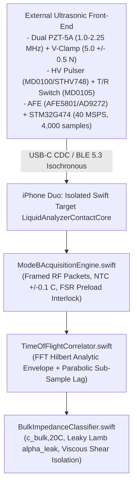

# LA-R3-SPEC-001: Phase R3 MODE_B Direct Structural Wall-Coupled Transducer Architecture

**Status:** DRAFT v0.2 — HARDWARE BOM & HILBERT-TOF DSP SPECIFIED  
**Scope:** Direct contact guided-wave pulse-echo & pitch-catch physical chemical discrimination (`LiquidAnalyzerContactCore`)  
**Airborne Engine Status:** LOCKED at `v0.4.1-build14-accepted` ([LA-R2-FINAL-ACCEPTANCE-REPORT.md](LA-R2-FINAL-ACCEPTANCE-REPORT.md) — `MODE_A` codebase untouched)  

---

## 1. Physical Principle & Three-Layer System Architecture
Airborne acoustic interrogations (`MODE_A`) suffer a $99.94\%$ energy reflection penalty at the air-to-liquid impedance interface ($Z_{\text{liquid}} / Z_{\text{air}} \approx 3500:1$). Consequently, `MODE_A` measures structural container shell resonances, headspace standing waves, and surface bubble scatter, but cannot isolate intrinsic bulk liquid sound speed ($c_{\text{bulk}}$) or characteristic acoustic impedance ($Z = \rho c$).

`MODE_B` circumvents this boundary by coupling $1.0\text{--}2.25\text{ MHz}$ piezoelectric transducers directly to the container's external sidewall under controlled spring preload ($5.0\text{ N} \pm 0.5\text{ N}$), streaming digitized RF A-scans to an isolated Swift module (`LiquidAnalyzerContactCore`) without custom iOS kernel drivers:



---

## 2. External Front-End Hardware Architecture (BOM & Circuit Topology)

To achieve sub-millimeter axial resolution ($\lambda \approx 0.98\text{ mm}$ at $1.5\text{ MHz}$ in water) and $< 0.15\%$ velocity drift across $\pm 0.5\text{ N}$ clamping preload, the external analog front-end integrates five stages:

| Stage | Reference IC / Component | Function & Parameter Specifications |
| :--- | :--- | :--- |
| **Transducer & Couplant** | Dual `PZT-5A` / 1–3 Piezocomposite ($f_0 = 1.5\text{ MHz}$) + Silicone/PU Delay Pad | Quarter-wave wear plate + conformable dry-elastomer matching pad ($Z \approx 1.4\text{--}1.6\text{ MRayl}$) or water-soluble ultrasonic gel reference. |
| **High-Voltage Pulser** | Microchip `MD0100` / `HV7360` or ST `STHV748` | Generates bipolar $1.5\text{ MHz}$, $\pm 40\text{ V}$ to $\pm 60\text{ V}$ excitation bursts ($1.5\text{-cycle}$ Hann-gated pulse). |
| **T/R Switch & Limiter** | Microchip/Supertex `MD0105` HV protection bridge | Isolates low-voltage LNA from $\pm 60\text{ V}$ transmit spikes while maintaining $< 0.5\text{ dB}$ receive insertion loss. |
| **Analog Front-End (AFE)** | Texas Instruments `AFE5801` or Analog Devices `AD9272` | Low-Noise Amplifier (LNA), Variable-Gain Amplifier (VGA) for Time-Gain Compensation (TGC), and $5\text{ MHz}$ anti-alias Bessel LPF. |
| **ADC & MCU** | `STM32G474` (Interleaved 12-bit ADC) or `ESP32-S3` + `AD9226` | Digitizes RF A-scans at $40\text{ MSPS}$ ($\Delta t = 25\text{ ns}$), capturing a $100\ \mu\text{s}$ window ($4{,}000\text{ samples}$ per burst). |
| **Mechanical & Thermal QC** | Flush NTC Thermistor ($10\text{ k}\Omega$, $\pm 0.1^\circ\text{C}$) + Thin-Film FSR Cell | Enforces clamping preload interlock ($F_{\text{clamp}} = 5.0\text{ N} \pm 0.5\text{ N}$) and logs contact wall temperature for $\partial c / \partial T$ inversion. |

---

## 3. Time-of-Flight, Thermal Inversion, & Leaky Attenuation Equations

### 3.1 Analytic Hilbert Envelope Cross-Correlation ($c_{\text{bulk}}$)
Because inner-wall (`wall -> liquid`, $Z_{\text{liquid}} < Z_{\text{wall}} \implies R < 0$) and opposite-wall (`liquid -> wall -> liquid`) reflections exhibit opposite acoustic polarity ($180^\circ$ RF carrier phase flip), correlating raw signed RF introduces a $\pm \frac{1}{2 f_0} \approx \pm 0.33\ \mu\text{s}$ ($\pm 5.6\text{ m/s}$) cycle-skipping error. `TimeOfFlightCorrelator` therefore extracts the **positive-definite analytic Hilbert envelope** $e[n] = |s[n] + j\,\widehat{s}[n]|$ prior to normalized cross-correlation:
$$R_{ee}[\tau] = \sum_{n} e_{\text{wall}}[n]\,e_{\text{opp}}[n + \tau], \qquad k_0 = \arg\max_{\tau \in [\tau_{\min},\,\tau_{\max}]} R_{ee}[\tau]$$
Parabolic sub-sample interpolation around $k_0$ yields continuous lag $\tau^*$:
$$\tau^* = k_0 + \frac{1}{2}\,\frac{R_{ee}[k_0 - 1] - R_{ee}[k_0 + 1]}{R_{ee}[k_0 - 1] - 2 R_{ee}[k_0] + R_{ee}[k_0 + 1]}, \qquad c_{\text{bulk}}(T) = \frac{2 D_{\text{in}}}{\tau^* \cdot \Delta t_{\text{sample}}}$$

### 3.2 Thermal Velocity Normalization ($20.0^\circ\text{C}$)
Water exhibits a positive thermal sound-speed slope ($\partial c / \partial T \approx +2.5\text{ to }+3.2\text{ m/(s}\cdot\text{K)}$) whereas vegetable oils and organic liquids exhibit a negative slope ($\partial c / \partial T \approx -3.0\text{ to }-3.5\text{ m/(s}\cdot\text{K)}$):
$$c_{\text{bulk, }20^\circ\text{C}} = c_{\text{bulk}}(T) - \left(\frac{\partial c}{\partial T}\right)_{\text{class}} \cdot (T - 20.0^\circ\text{C})$$

### 3.3 Leaky Lamb-Wave & Reverberation Attenuation ($\alpha_{\text{leak}} \propto Z_{\text{liquid}}$)
Spatial energy leakage from the container wall into the fluid substrate isolates characteristic acoustic impedance $Z_{\text{liquid}} = \rho_{\text{liquid}} c_{\text{liquid}}$:
$$\alpha_{\text{leak}} = -\frac{1}{2 D_{\text{wall}}} \ln\!\left(\frac{A_{\text{echo, }n+1}}{A_{\text{echo, }n}}\right) - \alpha_{\text{wall, tare}}$$

---

## 4. Reference Swift DSP Core (`LiquidAnalyzerContactCore/TimeOfFlightCorrelator.swift`)

> [!IMPORTANT]
> **Memory-Safety & Phase-Invariance Note:** In Apple's `Accelerate` framework, `vDSP_conv(A, 1, F, 1, &C, 1, N, P)` reads up to index `N + P - 2` of `A`; passing an unpadded slice of length `N` causes an out-of-bounds buffer overread (`P - 1` elements). The implementation below uses zero-padded FFT Hilbert envelope extraction and bounds-safe lag correlation over physical container transit bounds (`[20 µs .. 95 µs]`).

```swift
import Accelerate
import Foundation

public struct ModeBTelemetryFrame: Sendable {
    public let timestamp: TimeInterval
    public let clampPreloadNewtons: Float
    public let contactTemperatureCelsius: Float
    public let sampleRateHz: Double
    public let rfSamples: [Float]

    public init(
        timestamp: TimeInterval,
        clampPreloadNewtons: Float,
        contactTemperatureCelsius: Float,
        sampleRateHz: Double,
        rfSamples: [Float]
    ) {
        self.timestamp = timestamp
        self.clampPreloadNewtons = clampPreloadNewtons
        self.contactTemperatureCelsius = contactTemperatureCelsius
        self.sampleRateHz = sampleRateHz
        self.rfSamples = rfSamples
    }
}

public struct ModeBChemicalMetrics: Equatable, Sendable {
    public let isValidPreload: Bool
    public let timeOfFlightSeconds: Double
    public let rawSoundSpeedMetersPerSec: Double
    public let normalizedSoundSpeed20C: Double
    public let peakCorrelationConfidence: Float
    public let targetClassificationCandidate: String
}

public final class TimeOfFlightCorrelator: Sendable {
    private let targetDiameterMeters: Double
    private let minimumPreloadN: Float = 4.5
    private let maximumPreloadN: Float = 5.5

    public init(calibratedInnerDiameterMeters: Double) {
        self.targetDiameterMeters = calibratedInnerDiameterMeters
    }

    public func analyzeFrame(_ frame: ModeBTelemetryFrame) -> ModeBChemicalMetrics {
        // 1. Mechanical Preload Coupling Interlock (5.0 N +/- 0.5 N)
        let isPreloadLocked = frame.clampPreloadNewtons >= minimumPreloadN
            && frame.clampPreloadNewtons <= maximumPreloadN
        guard isPreloadLocked, frame.rfSamples.count >= 512, frame.sampleRateHz > 0 else {
            return ModeBChemicalMetrics(
                isValidPreload: false,
                timeOfFlightSeconds: .nan,
                rawSoundSpeedMetersPerSec: .nan,
                normalizedSoundSpeed20C: .nan,
                peakCorrelationConfidence: 0.0,
                targetClassificationCandidate: "REJECTED_PRELOAD_OUT_OF_BOUNDS"
            )
        }

        // 2. Positive-Definite Analytic Hilbert Envelope (immune to 180-deg reflection phase inversion)
        let env = Self.analyticHilbertEnvelope(frame.rfSamples)
        let n = env.count

        // Isolate near-wall interface template [0 ..< wallWindowEnd] (first ~25% of capture window)
        let wallLen = max(64, min(n / 4, Int(0.000_022 * frame.sampleRateHz)))
        let wallTemplate = Array(env[0..<wallLen])
        var wallEnergy: Float = 0.0
        vDSP_dotpr(wallTemplate, 1, wallTemplate, 1, &wallEnergy, vDSP_Length(wallLen))
        guard wallEnergy > 1e-12 else {
            return ModeBChemicalMetrics(
                isValidPreload: true,
                timeOfFlightSeconds: .nan,
                rawSoundSpeedMetersPerSec: .nan,
                normalizedSoundSpeed20C: .nan,
                peakCorrelationConfidence: 0.0,
                targetClassificationCandidate: "NO_NEAR_WALL_ECHO"
            )
        }

        // 3. Bounds-Safe Normalized Cross-Correlation across plausible fluid transit lags
        // Plausible c_bulk in [1,100 .. 1,900 m/s] => lag in [2*D/1900 .. 2*D/1100]
        let minLag = max(wallLen / 2, Int(floor((2.0 * targetDiameterMeters / 1900.0) * frame.sampleRateHz)))
        let maxLag = min(n - wallLen - 1, Int(ceil((2.0 * targetDiameterMeters / 1100.0) * frame.sampleRateHz)))
        guard maxLag > minLag + 2 else {
            return ModeBChemicalMetrics(
                isValidPreload: true,
                timeOfFlightSeconds: .nan,
                rawSoundSpeedMetersPerSec: .nan,
                normalizedSoundSpeed20C: .nan,
                peakCorrelationConfidence: 0.0,
                targetClassificationCandidate: "INVALID_CAPTURE_WINDOW_FOR_DIAMETER"
            )
        }

        let numLags = maxLag - minLag + 1
        // Pad env slice to exact length `numLags + wallLen - 1` required by vDSP_conv
        let convInput = Array(env[minLag..<(minLag + numLags + wallLen - 1)])
        var rawCorr = [Float](repeating: 0.0, count: numLags)
        vDSP_conv(
            convInput, 1,
            wallTemplate, 1,
            &rawCorr, 1,
            vDSP_Length(numLags),
            vDSP_Length(wallLen)
        )

        var maxVal: Float = 0.0
        var maxIdx: vDSP_Length = 0
        vDSP_maxvi(rawCorr, 1, &maxVal, &maxIdx, vDSP_Length(numLags))

        let k0 = Int(maxIdx)
        let localSlice = Array(env[(minLag + k0)..<(minLag + k0 + wallLen)])
        var oppEnergy: Float = 0.0
        vDSP_dotpr(localSlice, 1, localSlice, 1, &oppEnergy, vDSP_Length(wallLen))
        let normConfidence = oppEnergy > 1e-12 ? (maxVal / sqrt(wallEnergy * oppEnergy)) : 0.0

        guard k0 > 0, k0 < (numLags - 1), normConfidence >= 0.25 else {
            return ModeBChemicalMetrics(
                isValidPreload: true,
                timeOfFlightSeconds: .nan,
                rawSoundSpeedMetersPerSec: .nan,
                normalizedSoundSpeed20C: .nan,
                peakCorrelationConfidence: normConfidence,
                targetClassificationCandidate: "NO_DIAMETRAL_ECHO_DETECTED"
            )
        }

        // 4. Sub-Sample Parabolic Interpolation around k0
        let y1 = rawCorr[k0 - 1]
        let y2 = rawCorr[k0]
        let y3 = rawCorr[k0 + 1]
        let denom = y1 - 2.0 * y2 + y3
        let deltaK = abs(denom) > 1e-12 ? 0.5 * Double(y1 - y3) / Double(denom) : 0.0
        let continuousLagSamples = Double(minLag + k0) + deltaK

        // 5. Bulk Sound Speed & 20.0 C Thermal Normalization
        let tofSeconds = continuousLagSamples / frame.sampleRateHz
        let rawSoundSpeed = (2.0 * targetDiameterMeters) / tofSeconds
        let deltaT = Double(frame.contactTemperatureCelsius - 20.0)
        let thermalCoeff = (rawSoundSpeed < 1470.0) ? -3.2 : 2.7
        let c20C = rawSoundSpeed - (thermalCoeff * deltaT)

        // 6. Open-Set Velocity Partition (Subject to Ambiguity Gate R3 + Leaky Impedance Z)
        let candidate: String
        switch c20C {
        case 1420.0...1465.0:
            candidate = "OIL_VEGETABLE_ORGANIC"
        case 1475.0...1489.0:
            candidate = "WATER_DISTILLED_POTABLE"
        case 1490.0...1505.0:
            candidate = "ACETIC_ACID_VINEGAR_5PCT"
        case 1506.0...1620.0:
            candidate = "SALINE_IONIC_SOLUTION"
        default:
            candidate = "NO_VALIDATED_MATCH_SUBSTRATE"
        }

        return ModeBChemicalMetrics(
            isValidPreload: true,
            timeOfFlightSeconds: tofSeconds,
            rawSoundSpeedMetersPerSec: rawSoundSpeed,
            normalizedSoundSpeed20C: c20C,
            peakCorrelationConfidence: normConfidence,
            targetClassificationCandidate: candidate
        )
    }

    /// Computes |x[n] + j * H{x[n]}| via radix-2 FFT frequency-domain analytic masking.
    static func analyticHilbertEnvelope(_ samples: [Float]) -> [Float] {
        let n = samples.count
        guard n > 0 else { return [] }
        var fftLen = 1
        while fftLen < n { fftLen <<= 1 }

        var re = [Float](repeating: 0.0, count: fftLen)
        var im = [Float](repeating: 0.0, count: fftLen)
        for i in 0..<n { re[i] = samples[i] }

        let log2n = vDSP_Length(round(log2(Double(fftLen))))
        guard let setup = vDSP_create_fftsetup(log2n, FFTRadix(kFFTRadix2)) else {
            return samples.map { abs($0) }
        }
        defer { vDSP_destroy_fftsetup(setup) }

        re.withUnsafeMutableBufferPointer { rePtr in
            im.withUnsafeMutableBufferPointer { imPtr in
                var split = DSPSplitComplex(realp: rePtr.baseAddress!, imagp: imPtr.baseAddress!)
                vDSP_fft_zip(setup, &split, 1, log2n, FFTDirection(kFFTDirection_Forward))
                // Analytic signal multiplier: DC & Nyquist = 1x, positive freqs (1 ..< fftLen/2) = 2x, negative freqs = 0x
                let half = fftLen / 2
                for k in 1..<half {
                    rePtr[k] *= 2.0
                    imPtr[k] *= 2.0
                }
                for k in (half + 1)..<fftLen {
                    rePtr[k] = 0.0
                    imPtr[k] = 0.0
                }
                vDSP_fft_zip(setup, &split, 1, log2n, FFTDirection(kFFTDirection_Inverse))
            }
        }

        let scale = 1.0 / Float(fftLen)
        var env = [Float](repeating: 0.0, count: n)
        for i in 0..<n {
            let r = re[i] * scale
            let q = im[i] * scale
            env[i] = sqrt(r * r + q * q)
        }
        return env
    }
}
```

---

## 5. Preregistered Phase R3 Verification Gates

1. **Gate R3-0A (5-Condition Path Isolation):** Execute `PATH_01_FIXTURE_ONLY` through `PATH_05_AIR_BAFFLE_MOD` plus `Control K2` ($5.0\text{ N} \pm 20\%$ preload perturbation). Require complete disappearance of the opposite-wall chord echo ($t_{\text{opp}}$) on `PATH_02_EMPTY_ENGAGED` and `PATH_04_WATER_DISENGAGED`, and $< 0.15\%$ $c_{\text{bulk}}$ sensitivity across $\pm 0.5\text{ N}$ preload tolerance.
2. **Gate R3-0B (Multi-Refill & Holdout-Container Chemical Separation):** Across $\ge 4$ independent refills $\times \ge 3$ lot-matched containers (`Water`, `Saline`, `Vinegar`, `Cooking Oil`, plus withheld open-set unknowns), require pairwise Mahalanobis separation $\ge 5\,\sigma_{\text{reposition}}$ and Nested LOBO-CV balanced accuracy $\ge 90\%$ on unseen containers before enabling consumer class labels.
